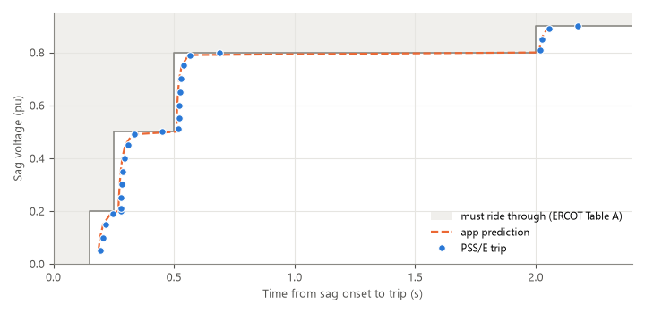

# Model behavior and limitations

The PERC1 model's documentation says what each CON is, but not exactly how
the compiled model uses it. To find out, every preset was run in PSS/E
v35.6.4 against the compiled PERC1 model and compared with this app's own
simulator:

- **840 preset tests:** each preset `.dyr` exactly as the app exports it,
  through sags, swells, recoveries, operating-voltage checks and frequency
  events.
- **198 targeted probes:** each behavior found above, pinned down to an
  exact rule. All 744 of 744 rule checks against the PSS/E traces pass.

This page gives the results that matter when you use the app. **The `.dyr`
file is what PSS/E runs. The live chart is a fast simulation of it** that
follows every rule on this page. Against the PSS/E traces, its voltage trips
land within three PSS/E time steps (about 12 ms), and it agrees on every
reconnect-or-stay-tripped outcome. It does not model PSS/E's own
bus-frequency filter, so frequency trips land about 0.05 s earlier than
PSS/E.

## Summary

| Behavior in PSS/E | Who is affected | Impact |
|---|---|---|
| [Reconnection needs the voltage inside a window](#reconnection-needs-the-voltage-inside-a-window), `VRPA` < V < `VRUPA` | The five presets with `VRPA = 1.00`: ERCOT, PJM, MISO, NERC LLWG SAR, NERC PRC-029-1 | **High.** They stay tripped unless the voltage settles above 1.00 pu |
| [Constant-power blocks are current-limited](#constant-power-blocks-are-current-limited) | Blocks with `NPA = 0` | Medium. Much less load in a deep sag |
| [Frequency droop is large and always on](#frequency-droop-is-large-and-always-on) | Every preset (`DROOPA = 10`) | **High** for frequency studies |
| [Trips use the filtered voltage, strictly](#trip-timing-filtered-voltage-strict-thresholds) | All | Low. Trips land 10-70 ms later |
| [Stage timers reset; durations don't add up](#stage-timers-reset-durations-dont-add-up) | All | Low |
| [If `VRPA` is below a trip stage, the block cycles](#if-vrpa-is-below-a-trip-stage-the-block-cycles) | Hand-edited values only | High, if it happens |

The live chart shows all six. Its event is a single constant-depth sag,
swell or frequency step that recovers to nominal, so a `VRPA = 1.00` block
stays tripped there.

What the app assumes about **which** CONs are live is confirmed:

- the 4-stage voltage trip table (every stage);
- one frequency trip point per direction;
- overvoltage trips reconnect on `VRUPA`/`TRUPA`/`RAMPUA`, and frequency
  trips on their own reconnect CONs;
- `FCEASE`/`FRECON` apply to frequency trips too;
- all five record formats (Bus, Owner, Zone, Area, All).

## The multi-stage trip table works as published

*ERCOT NOGRR282 preset, IT block. Each dot is one PSS/E run: a sag to that
voltage, held longer than every stage delay. The shaded area is where
ERCOT's Table A requires the load to ride through. The dashed line is the
app's live chart for the same sags.*

Every PSS/E trip lands on or just after the published staircase, never inside
it. The app follows the same curve: it includes the `TVM` filter lag that
pushes trips later near each stage voltage, and its trips land within three
PSS/E time steps of PSS/E's. A sag held exactly at a stage voltage is the one
exception (see [Trip timing](#trip-timing-filtered-voltage-strict-thresholds)).

## Reconnection needs the voltage inside a window

*ERCOT preset (`VRPA = 1.00`), tripped by a 0.30 pu sag at 0.5 s. (a) Bus
voltage: after the sag it recovers to either 0.99 pu or 1.01 pu, which look
the same at full scale; the inset magnifies the recovery against `VRPA`.
(b) Active power: the block that recovers to 1.01 pu (above `VRPA`)
reconnects about one second later; the one at 0.99 pu stays tripped. The
app's simulator (dashed) gives the same two outcomes.*

After a voltage trip, the reconnect timer runs only while the filtered
voltage is **strictly inside `VRPA` < V < `VRUPA`**. This applies after
both undervoltage and overvoltage trips. Leaving the window restarts the
timer; once the ramp has started, nothing stops it.

*Each circle is one PSS/E run: a trip, then the bus voltage held at the
value on the horizontal axis. Filled circles reconnected; open circles
stayed tripped. Each row is one CON set and trip direction, and its shaded
band is the window between `VRPA` and `VRUPA`. Only recoveries strictly
inside the band reconnect, after undervoltage and overvoltage trips alike.*

**What this means for the grid-operator presets.** ERCOT, PJM, MISO, NERC
LLWG SAR and NERC PRC-029-1 ship with `VRPA = 1.00` and the vendor
`VRUPA = 1.05`. Their reconnect window is 1.000-1.050 pu. After a fault,
the voltage at a load bus usually settles a little *below* its pre-fault
value, and then these blocks **stay tripped for the rest of the
simulation**. That is the opposite of the fast recovery these standards
require. The live chart shows this: its event recovers to exactly 1.00 pu,
so these presets stay tripped there, and the status line says why.

**What to do.**

- For a study, set `VRPA` below the lowest credible post-fault voltage,
  for example 0.90-0.95 pu (the standards' own continuous-operation floor),
  in the **Voltage ride-through** parameter row, under **Undervoltage
  reconnect**.
- Do not set `VRPA` below the highest undervoltage stage voltage (next
  section).
- Frequency reconnects the same way: only while `FUFRN1` < f < `FOFRN1`.

Choosing a new default `VRPA` for these presets is [future work](roadmap.md#future-work).

## If `VRPA` is below a trip stage, the block cycles

*`VRPA` = 0.85 pu, below stage 1 at `VDPA` = 0.90 pu. At 0.87 pu the block
is above `VRPA` (so it reconnects) and below `VDPA` (so it trips again), and
it cycles every `TDRA` + `DMA` for as long as the voltage stays there. At
0.92 pu it reconnects once and stays on.*

No shipped preset does this. Every preset has `VRPA` at or above its
highest undervoltage stage voltage. A hand edit can create it, so keep
`VRPA` ≥ the highest `VDPA` stage. `VRPA` equal to `VDPA` is safe.

## Constant-power blocks are current-limited

*Steady active power against voltage, with tripping turned off. Constant-power
(`NPA = 0`) blocks follow P = 1 only down to `LFM`/`IPMAXA`; below that,
power falls in proportion to voltage.*

In PSS/E, P = min(Pref·V^`NPA`, V·`IPMAXA`/`LFM`), and Q is limited the same
way by `IQMAXA`, separately. `LFM` is the block's power factor, so the
current limit is on a base of MW/`LFM` (with `LFM` = 0.8 in every preset).

- Generic tiers with `IPMAXA = 1.0`: the limit binds below 0.80 pu.
- ERCOT (`IPMAXA = 1.25`): below 0.64 pu. At 0.30 pu the block draws
  0.47 pu, not 1.0.
- PJM (`IPMAXA = 1.5`): below 0.53 pu.
- Constant-current blocks (`NPA = 1`) draw P = V, and constant-impedance
  blocks (`NPA = 2`) P = V²; neither reaches the limit in a sag.

*The rule, tested across settings. (a) Steady active power against voltage
for five `NPA` and `IPMAXA`/`LFM` combinations; (b) steady reactive power for
four `NQA` and `IQMAXA` combinations. Dots are PSS/E; lines are the rule
above. Each curve follows its ZIP exponent until it meets its own current
limit, a straight line through the origin with slope `IPMAXA`/`LFM` (or
`IQMAXA`/`LFM`). P and Q are limited independently.*

The live chart applies the limit, so it shows the reduced load in a deep sag
(the dashed line above). It also shows the model's short transients: a dip
and quick recovery at sag onset, an overshoot to about 1/V when the voltage
recovers, and a decay over `TRA` after a trip.

**Keep `IPMAXA`/`LFM` ≥ 1.** Below that, the block cannot draw its own
power-flow load. In PSS/E it drifts to `IPMAXA`/`LFM` at t = 0 with no
disturbance. No preset does this. The live chart starts such a block at
`IPMAXA`/`LFM` and says so in its status line.

## Frequency droop is large and always on

*ERCOT preset, steady active power against frequency. Every preset uses
`DROOPA = 10`.*

P = Pref·V^`NPA`·(1 + `DROOPA`·Δf/60), where Δf is the deviation beyond the
deadband `DBA` (in Hz; every preset uses 0). With `DROOPA = 10`, load changes
by **16.7% per Hz**: −25% at 58.5 Hz, +30% at 61.8 Hz (capped by the current
limit). Reactive power is unaffected.

- The live chart's frequency event applies the droop, so at 58.5 Hz it shows
  the 25% load reduction PSS/E does.
- Over-frequency increases load, which makes an over-frequency event worse.
- PJM's proposal asks the load to stay within 10% of its pre-disturbance
  level down to 57.0 Hz. That needs `DROOPA` ≤ 2 (or 0, or a `DBA`
  deadband). With `DROOPA = 10`, the block leaves that band at 59.4 Hz.

*The rule, tested across settings. (a) `DROOPA` sets the slope: 0, 8.3,
16.7 and 33.3% of load per Hz for `DROOPA` = 0, 5, 10 and 20. (b) `DBA` is a
deadband in Hz around 60 Hz: inside it power stays at 1.0, and outside it
the droop resumes from the deadband edge (no step). Dots are PSS/E; lines
are the rule.*

Set `DROOPA` in the **Other** parameter row if the facility's
real frequency response is known. `DROOPA = 0` holds constant
power.

## Trip timing: filtered voltage, strict thresholds

- Stage timers use the terminal voltage through the `TVM` filter, not the
  raw voltage. Trips land about 10-70 ms after the delay, and up to about
  0.2 s later for a sag just inside a threshold.
- Every comparison is **strict**. A voltage held exactly at a threshold is
  decided by about 0.00005 pu, so treat "exactly at the line" as
  unpredictable.
- `CMTDELAY` adds a delay to every trip, and `CMTDELAYC` to every reconnect
  (both are 0 in every preset).
- A frequency trip lands about 0.08 s after its delay, because of PSS/E's
  bus-frequency filter and `TFRQ`. That is negligible against the 100-299 s
  preset delays. The live chart includes `TFRQ` but not the bus-frequency
  filter, which is a study setting.
- The live chart follows all of this, except that it decides a level held
  exactly at a threshold as not crossing it.

### Check the operating voltage first

Some presets trip at a **steady** voltage, with no disturbance:

| Preset | Trips at a steady voltage of |
|---|---|
| Minimal / unknown | above 1.05 pu, immediately (its stages 2-4 are 1.05 pu with no delay) |
| ERCOT, SPP, MISO, NERC LLWG SAR | 0.90 pu or below, after 2.0 s (`VDPA = 0.90` is their continuous floor) |
| NERC PRC-029-1 | 0.90 pu or below, after 6.0 s |
| Standard, Extended, PJM | neither case |

Check the load bus voltages in the power-flow case before choosing a
preset.

## Stage timers reset; durations don't add up

*ERCOT preset. (a) Two 0.4 s sags to 0.75 pu separated by 0.1 s at
1.0 pu: no trip, because the 0.80 pu / 0.50 s stage timer restarts. (b)
0.45 pu for 0.2 s then 0.75 pu: a trip at 0.52 s, because the timer runs at
any depth below the stage voltage.*

- A stage timer runs as long as the filtered voltage stays beyond the stage
  threshold, whatever the depth.
- It resets the moment the voltage recovers past the threshold, even for
  20 ms. **Ride-through durations are not cumulative.** (NERC PRC-029-1's
  frequency durations are cumulative over 10 minutes, which the model
  cannot represent.)
- The live chart simulates a single constant-depth event only.

## Reconnect ramps

A reconnect ramp takes exactly its CON (`RAMPA`, `RAMPUA`, `RUFRN1`,
`ROFRN1`) in a normal study, whatever fraction is reconnecting. The model
advances the ramp one extra time step on every `psspy.run` call, so a script
that calls `run()` at every time step (per-step monitoring, co-simulation)
sees ramps finish early, in half the time at one call per step. Trip and
reconnect timing do not depend on this.

## The PSS/E 36.7 standard model: edge-case behaviors

These apply when a block uses the **PERC1 Standard** model version (PSS/E
36.7.1, built in). Its cease and reconnect logic follows the data sheet:

Five edge cases are worth knowing; the editor warns about each.

- **A dip that ends while `Tdelay` is running can make PSS/E return
  not-a-number, or a wrong load, for the whole network, but only some of the
  time.** The window is as wide as `Tdelay`, starting when `Tcease` expires.
  Inside it the model always drops its load fraction to almost zero one step
  after the dip ends; what PSS/E's network solution does next varies from run to
  run. With `Tdelay` = 0 no dip length is affected, so the app uses 0.

  

  The plot is one recorded run. The same dip was then run 470 times in PSS/E
  36.7.1, each time in a fresh PSS/E process:

  | Result | Runs | Share |
  |---|---|---|
  | Not-a-number (identical to the recorded run) | 71 | 15 % |
  | A wrong load: finite, but up to about seven times the block's power for about 0.2 s | 12 | 3 % |
  | Normal | 387 | 82 % |

  All 71 not-a-number runs fell within one 28-minute stretch of an afternoon.
  The 255 runs after it were all normal, and so were the 72 before it apart from
  one wrong-load run. A first rerun of all 36 affected dips was normal in every
  case, although the original recording had been not-a-number in all 36. What
  decides the outcome is not known, so treat any dip that ends inside the window
  as unreliable. The details are in the developer documentation.

- **`Vrecon` at or above the post-fault voltage never reconnects.** The
  filtered voltage approaches its final value from below and must be
  strictly above `Vrecon`. The presets' `VRPA` of 1.00 would strand the load,
  so the standard model uses at most 0.95.

  

- **A constant-power block draws more than its normal power for about 0.1 s
  when a fault clears.** During the sag the block asks for extra current to
  hold its power, up to its current limit (`Ipmax`). The voltage returns
  before that current has relaxed, so power briefly equals
  `Ipmax / Ldfact` times the initial power: 155% with the presets' `Ipmax` of
  1.25 and a load factor of 0.8, 125% with `Ipmax` 1.0. A block with a
  voltage exponent (`nP`) of 1 or 2 has no spike. A block that is already
  ceasing on a long sag does not show it; a block that rides through a short
  fault does. This is what PSS/E computes, not a chart artifact. The
  editor shows a "Post-fault power peak" warning whenever a block could exceed
  110% of its power; lower `Ipmax` in the **Current limits** row to reduce it.

  

- **A voltage of exactly 0 pu returns not-a-number.** 0.05 pu is fine.
- **PSS/E silently changes some out-of-range values** (a `Tt` below twice the
  time step, a negative timer, `Vrecon` below `Vcease`) and ignores the model
  entirely for loads under 5 MW, with an active-to-reactive ratio under 1.61,
  or at a bus voltage of 0.97 pu or less.

## The PSS/E 36.7 PERC2 standard model: edge-case behaviors

These apply when a block uses the **PERC2 Standard** model version (PSS/E
36.7.1, built in). 443 PSS/E tests checked its data sheet line by line; all
609 rule checks against the PSS/E traces pass, and every preset was exported
by the app and run in PSS/E. The record and the order of its values are as
the data sheet says, and so is most of the logic:

What to know; the editor warns about each one it can.

- **The third point of each long table uses the first point's time.** In
  PSS/E 36.7.1 the load ceases after `TVLC1` (or `TVHC1`) below the third
  point's voltage, not after `TVLC3`. The app's presets leave the third point
  off and use points 1, 2 and 4.

  

- **A long sag inside the reconnect window can make the load cycle.** If a
  long-cease voltage is above the reconnect voltage (`VLrecon`), a sag between
  the two ceases the load, reconnects it while the sag is still there, and
  ceases it again, for as long as the sag lasts. The presets raise `VLrecon`
  to their highest long-cease voltage, so they cannot cycle.

  

- **`VHcease` limits reconnection even when the high-voltage check is off.**
  PSS/E lowers the top of the reconnect window to `VHcease` whatever its flag
  says, so a `VHcease` below the voltage after the event means the load never
  comes back. The app keeps `VHcease` at or above `VHrecon` and refuses a
  record that would strand the load.

  

- **A frequency cease is permanent**, unlike in the PERC1 DLL (which
  reconnects) and PERC1 standard (which has no frequency cease).

  

- **Below 0.7 pu the model ignores frequency.** Droop and the frequency
  cease both stop while the bus voltage is under 0.7 pu, so in a low-voltage,
  low-frequency event the load can draw about 25% more at 0.69 pu than at
  0.71 pu, and a frequency cease waits until the voltage is back.

  

- **A load factor (`Ldfact`) above the maximum active current (`Ipmax`)
  starts the load below its power flow, without a message.** The data sheet
  says a load factor above 1 is reset to 0.8; PSS/E uses it as given.

  

- **Unlike PERC1 standard, a dip that ends during `Tdelay` is fine.** PERC2
  does not return not-a-number there. A voltage of exactly 0 pu still does.
- **A second dip during the reconnect ramp ceases the load again**, as in
  both PERC1 models; the data sheet says the ramp cannot be interrupted.
- **Reconnection needs the filtered voltage strictly inside the window**
  (`VLrecon` < V < `VHrecon`); a recovery to exactly `VLrecon` never
  reconnects, so the presets cap `VLrecon` at 0.95 pu.

The three models on the same events:

## The PERC2 DLL (v2.3): edge-case behaviors

These apply when a block uses the **PERC2 DLL v2.3** model version
(`PERC2_v35_v2p3.dll` on PSS/E 35, `PERC2_v36_v2p3.dll` on PSS/E 36). The
same tests ran on both builds, and the same scenarios on the PERC1 DLL;
every rule check against the PSS/E traces passes. Everything v2.3 shares with
the PERC1 DLL - the four-stage tables, the reconnect window, cycling, the
current limit, droop - behaves exactly as described above. What is new or
different:

- **The PSS/E 36 build stops PSS/E when the load comes back from a
  high-voltage momentary cessation.** The whole PSS/E 36.7 process exits at
  the end of the reconnect ramp. The PSS/E 35 build does not. Keep momentary
  cessation off on PSS/E 36, or its high-voltage threshold (`VUBLK`) out of
  reach.

  

- **On the PSS/E 36 build, any `TA` or `TB` returns not-a-number**, and on
  both builds `TA` without `TB` (or `TAQ` without `TBQ`) does. Leave both 0.
- **`RAMPA` and `RAMPUA` are multiplied by the load factor; nothing else
  is.** A PERC1 DLL record moved to v2.3 unchanged reconnects 1.25 times
  faster at the usual `LFM` of 0.8. The app corrects for this.

  

- **Momentary cessation comes back inside `VLRCMC`-`VURCMC`, and only to
  `FRECON`.** A 0.79 pu recovery with `VLRCMC` 0.8 never reconnects (the
  PERC1 DLL's version would), and with `FRECON` below 1 every cessation
  loses part of the load for good.

  

- **A trip stage can take a cessation over.** If a stage trips while the
  load is in momentary cessation, it comes back on the stage's reconnect
  delay and ramp. The DLL's own sample record, with momentary cessation on,
  comes back after 10 s instead of 0.05 s.

  

- **The 50 Hz flag does nothing.** The DLL always measures frequency against
  60 Hz, so in a 50 Hz case its frequency trips misfire. Use it in 60 Hz
  cases only.
- **Out-of-range values are not checked by the DLL.** A trip fraction above
  1 makes the load export power; a negative ramp runs it below zero. The app
  refuses these before export.

## Feedback

If your own PSS/E results differ from this page, or you have questions about
these findings, open an issue on the project's [GitHub Issues](https://github.com/TimThacker/perc-studio/issues) page.
