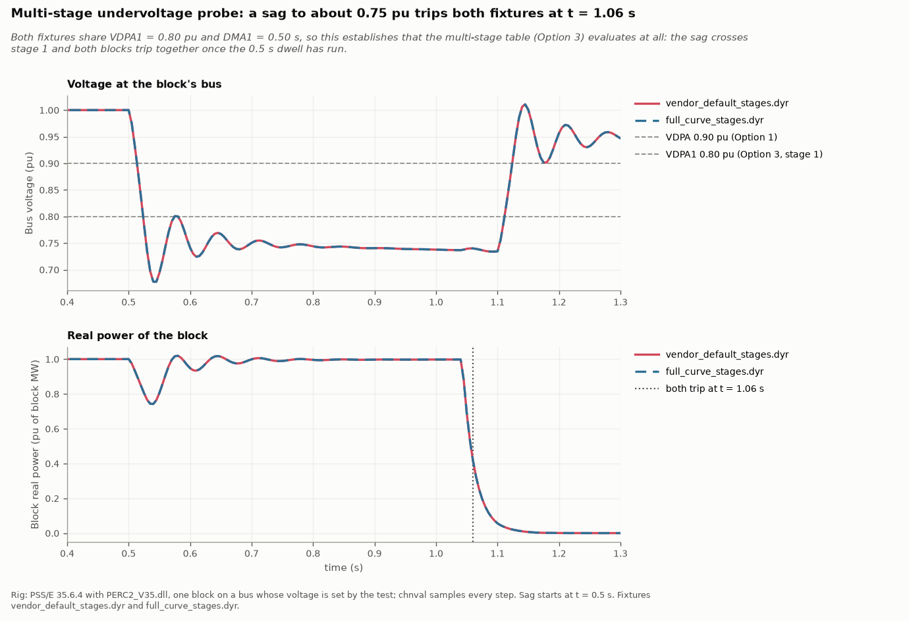
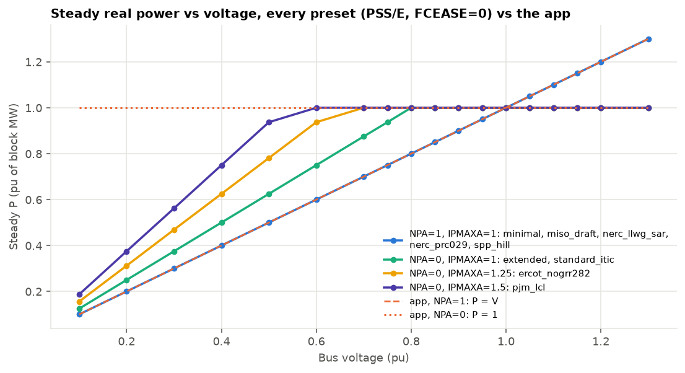
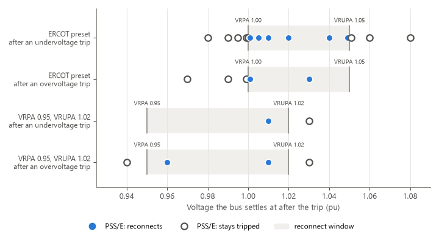
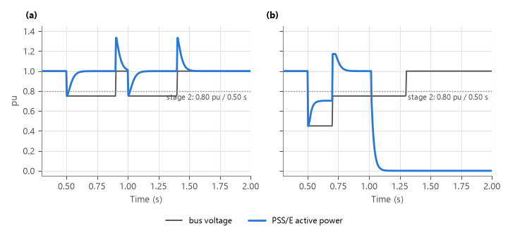
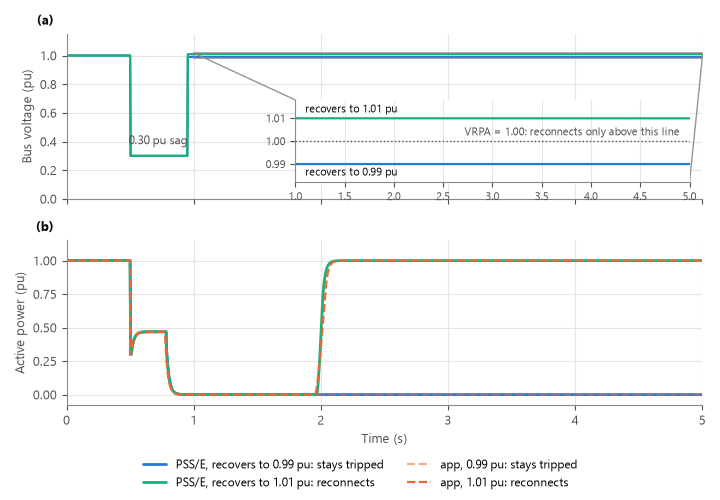
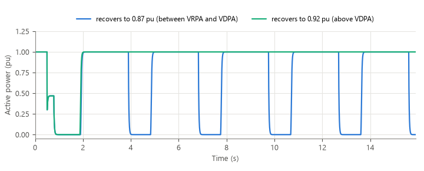
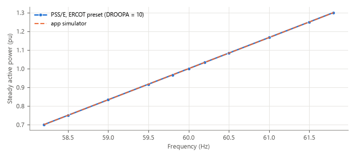
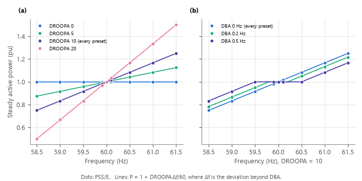
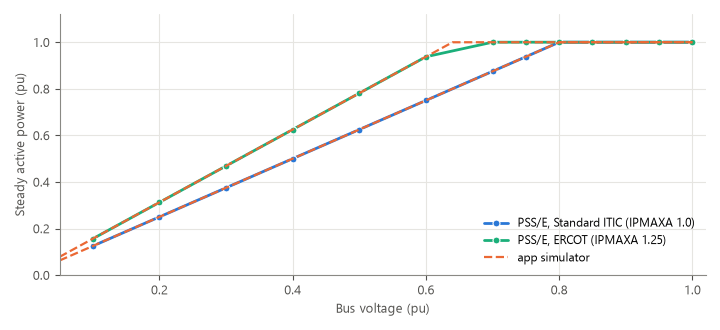
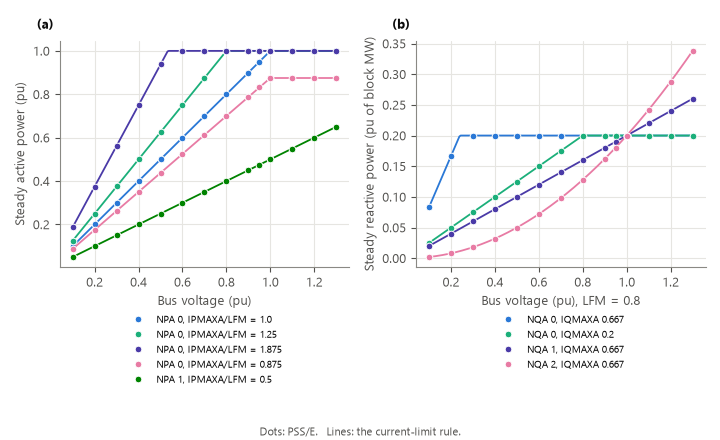

# PERC1 DLL: validation results

The PERC1 DLL is ISO New England's user-defined implementation of PERC1 (`PERC2_V35.dll`),
for PSS/E 34 and 35. It has the most detailed trip and reconnect logic of the PERC1
family: 173 CONs, a four-stage voltage trip table in each direction, frequency trip and
reconnect, momentary cessation and frequency droop. See the
[model overview](model_overview.md) for how it compares with the others, and the
[model reference](model_reference.md) for the CONs.

| | |
|---|---|
| **PSS/E version validated** | 35.6.4, with the compiled `PERC2_V35.dll` |
| **Needs** | the DLL, loaded as a user-defined model; no main-component record |
| **Record** | `USRLOD 'PERCBL' 12 IT 2 173 33 250 0`, two ICONs, 173 CONs |
| **PSS/E runs** | 840 preset tests plus 198 targeted probes |
| **Automatic checks** | 744 of 744 pass |

The PSS/E runs behind these counts are in the authors' PSS/E validation library, which is not published.

## How it was validated

Each of the app's ride-through presets, exactly as the app exports it, was run in PSS/E
through sags, swells, recoveries, operating-voltage checks and frequency events, and compared
with the app's live-chart simulator. A second round of 198 probes then pinned every
behavior the first round found down to an exact rule. Each rule became a formula, and each
formula is checked against the PSS/E traces.

Of the 818 comparable preset tests, 477 matched the app within tolerance at the time. Every
difference fell into one of the behaviors below, none was random, and none came from the
test rig. The app's simulator has since been changed to follow them.

## Results

| Behavior in PSS/E | What it means for a study |
|---|---|
| **The four-stage table is always live.** Every stage times on its own; whichever reaches its delay first trips the block. | Presets with fewer published steps repeat their deepest step into the unused stages. |
| **Reconnect needs the voltage strictly inside `VRPA` < V < `VRUPA`**, after under- and overvoltage trips alike. Leaving the window restarts the reconnect timer. | Five presets with `VRPA` = 1.0 never reconnected after a recovery to 1.0 pu. The app caps the reconnect voltage where the model needs it and the editor says so. |
| **A constant-power block is current-limited.** P is capped at V × `IPMAXA` / `LFM`. | During a deep sag the load draws up to 90 % less than a constant-power load would. |
| **Frequency droop is large and always on.** `DROOPA` = 10 changes P by 16.7 % per Hz. | −25 % at 58.5 Hz and +30 % at 61.8 Hz. |
| **Every threshold is strict and acts on the filtered voltage.** | A hold exactly at a threshold is a knife edge. Trips land 9-67 ms after the event, up to 0.22 s near a threshold. |
| **`VRPA` below a trip stage makes the block cycle.** It trips and reconnects every `TDRA` + `DMA` for as long as the sag lasts. | The editor warns. No preset does this. |
| **Reconnect ramps are exact.** The earlier appearance of half-length ramps came from how the test rig stepped PSS/E. | A normal study sees the configured ramp. |

### The multi-stage trip table

A sag to about 0.75 pu trips at the same time whether stages 2 to 4 are left at the vendor
sample's values or set to a preset's real curve: PSS/E evaluates the whole table.

### Steady power against voltage

Presets with `NPA` = 0 (constant power) hold full power only down to a voltage set by
their current limit; below that, P follows V × `IPMAXA` / `LFM`. Presets with `NPA` = 1
follow the voltage. The dotted and dashed lines are what the app assumed before this was measured.

### Reconnect

### Frequency droop

### Current limits

## What the app does with this

- The live chart follows every rule above. Against the PSS/E traces its voltage trips land
  within three PSS/E time steps (about 12 ms) and it agrees on every reconnect-or-stay-tripped
  outcome. It does not model PSS/E's own bus-frequency filter, so frequency trips land about
  0.05 s earlier than in PSS/E.
- Exported presets use the full four-stage tables, one frequency stage, and the
  reconnect values each standard's recovery window implies.
- Momentary cessation (Option 2) is off in exported records.
- A record whose header says 173 CONs is read as this model; one that says 179 is read as the
  [PERC2 DLL v2.3](model_perc2_dll.md), which shares the `PERCBL` name.

## Limits of this validation

- Only PSS/E 35.6.4 was run; versions 34 and 36 were not.
- Momentary cessation and the stage-takeover rules are covered in the
  [PERC2 DLL v2.3](model_perc2_dll.md) results, where both DLLs were run on the same cases.
