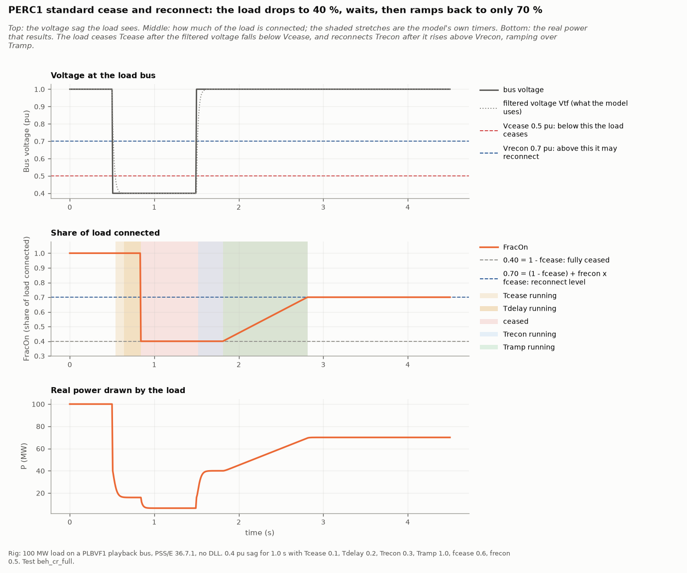
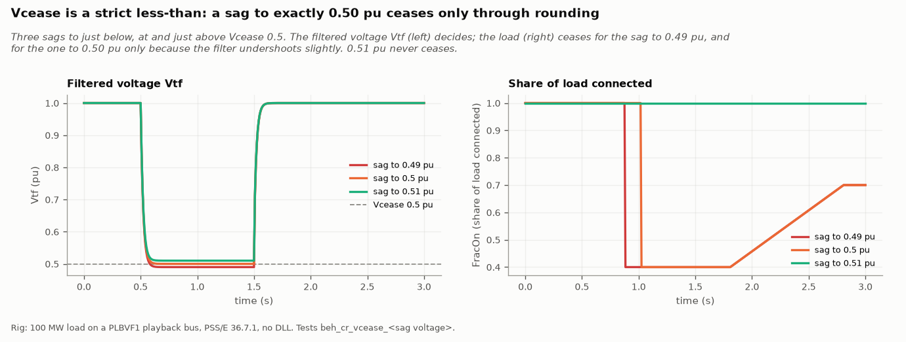
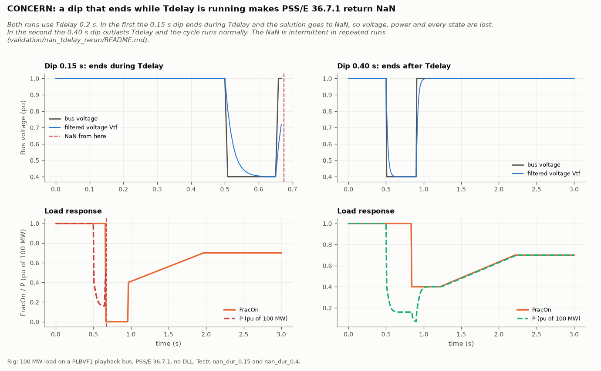
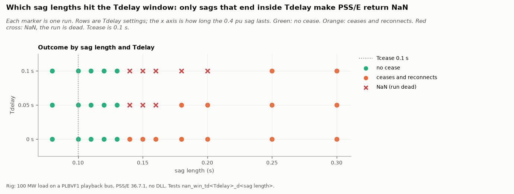
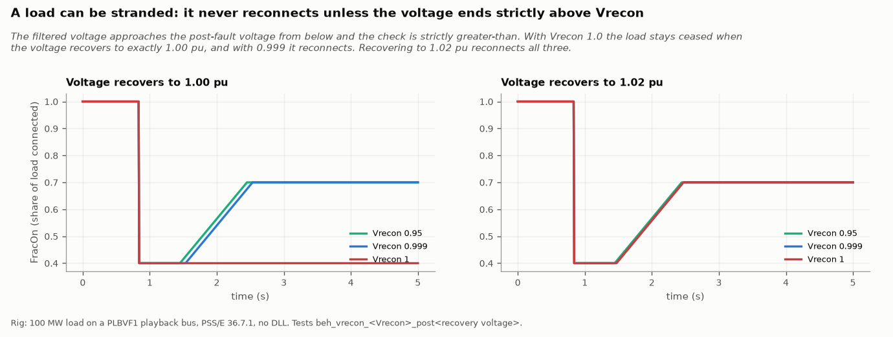
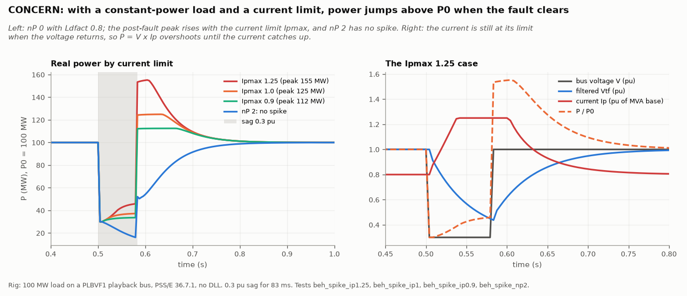
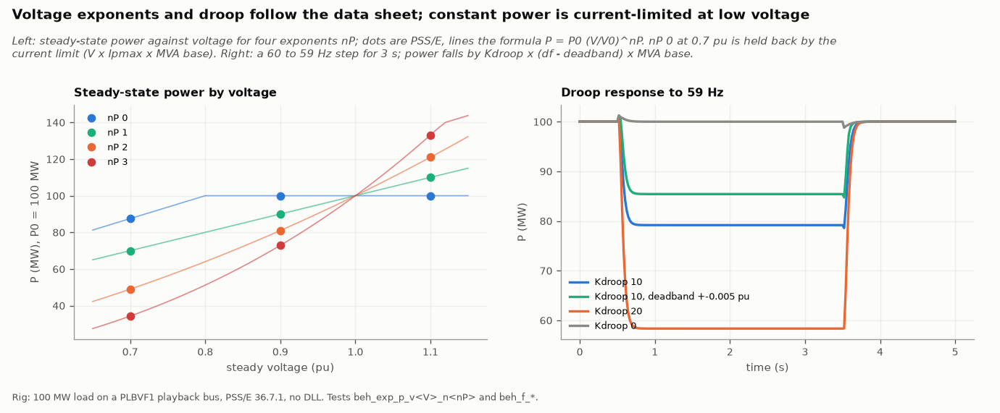

# PERC1 standard: validation results

PERC1 standard is the version of PERC1 that PSS/E 36.5 and later include as a library model
(`PERCxx1U`). It needs no DLL. It is a smaller model than the PERC1 DLL, with 30 CONs and a
single undervoltage cease and reconnect cycle, plus droop, voltage exponents and current
limits. See the [model overview](model_overview.md) for how it compares with the others and
the [model reference](model_reference.md) for the CONs.

| | |
|---|---|
| **PSS/E version validated** | 36.7.1 only. No DLL |
| **Needs** | a main-component record (`MAINxx10`) of the same scope and load ID above it |
| **Record** | `USRLODC 'PERCxx1U' 230 IT 0 30 8 24 2 CompNum 'CompDesc'`, then 30 CONs |
| **PSS/E runs** | 435 cases |
| **Automatic checks** | 262 of 262 pass |
| **Reference** | Siemens' model library, section 13.6 |

The PSS/E runs behind these counts are in the authors' PSS/E validation library, which is not published.

## How it was validated

Every field of the record, every CON and the full cease and reconnect sequence were run in
PSS/E 36.7.1, each alone, and the result was read from the model's own internal variables.
Every preset the app can export was then written as the app writes it (all five record scopes,
partial loads, and a second component slot) and run: it ceased after `Tcease`, dropped to
`1 - fcease`, reconnected after `Trecon`, ramped over `Tramp` and settled at the final level.

## Results

| Behavior in PSS/E | What it means for a study |
|---|---|
| **The model is silently off for small or low-ratio loads.** It applies only if the load is at least 5 MW, its active-to-reactive ratio is at least 1.61, and the bus is above 0.97 pu at initialization. These are checked once, at the start. | A 100 MW load with 80 Mvar gets no PERC model. A later sag below 0.97 pu does not switch it off. |
| **The data sheet's cease/reconnect machine is right.** After a sag, `FracOn` falls to `1 - fcease` after `Tcease` + `Tdelay`, and ramps to `(1 - fcease) + frecon × fcease` after `Trecon`. A dip shorter than `Tcease` does nothing, and a second dip during the ramp restarts the cycle. | |
| **There is no overvoltage or frequency cease.** 1.2 pu for 2 s changes nothing; 57 and 63 Hz change nothing except droop. | Presets that specify them are reduced to one undervoltage point. |
| **A dip that ends during `Tdelay` can make the network return not-a-number, or a wrong load, but only some of the time** (about one run in six on a repeated test). | The app and every preset use `Tdelay` = 0. |
| **A bus voltage of exactly 0 pu returns not-a-number.** 0.05 pu is fine. | |
| **`Vrecon` at or above the recovery voltage never reconnects.** The filtered voltage approaches its final value from below and must be strictly above `Vrecon`. | The presets' `VRPA` of 1.0 would strand the load; the app caps it at 0.95. |
| **A constant-power load spikes when a fault clears.** P reaches V × `Ipmax` / `Ldfact` for about 0.1 s: 155 % with `Ipmax` 1.25 and `Ldfact` 0.8. | The editor warns when a block could exceed 110 %. |
| **Several out-of-range values are changed without a message** (a `Tt` below twice the time step, a negative timer, `Vrecon` below `Vcease`). | The editor flags them. |
| **Header counts are not checked against the model.** A wrong CON, state or variable count shifts the memory of everything after it; a reserved-ICON count of 0 corrupts the run. | The app writes exactly `30 8 24` and `2`. |

### The cease and reconnect cycle

A 0.4 pu sag with `Tcease` 0.1 s, `Tdelay` 0.2 s, `Trecon` 0.3 s, `Tramp` 1.0 s, `fcease` 0.6
and `frecon` 0.5. `FracOn` falls to 0.4, waits for the recovery, and ramps to 0.7.

### The cease voltage is a strict, filtered threshold

The load ceases only if the filtered voltage is strictly below `Vcease`. A dip to exactly the
threshold is decided by rounding, so test a margin either side of it.

### The `Tdelay` hazard

The affected dip lengths are exactly the window of width `Tdelay` that opens when `Tcease`
expires. With `Tdelay` = 0 no dip length is affected.

The plots show one recorded run. In it, the model dropped its load fraction to almost zero one
step after each affected dip ended (this happens every time), and PSS/E then returned
not-a-number in all 36 affected cases. It does not do so every time. The same dip, run 470
times in PSS/E 36.7.1 in fresh processes:

| Result | Runs | Share |
|---|---|---|
| Not-a-number (identical to the recorded run) | 71 | 15 % |
| A wrong load: finite, but up to about seven times the block's power for about 0.2 s | 12 | 3 % |
| Normal | 387 | 82 % |

All 71 not-a-number runs fell within one 28-minute stretch; the 255 runs after it were all
normal. A first rerun of the 36 affected dips was normal in every case. The cause is not known,
so a dip that ends inside the window gives an unreliable result whichever way a single run
comes out.

### Reconnecting

### Power spike after a fault

### Voltage exponents and droop

Steady power follows P₀ × (V / V₀)^`nP` exactly, for any real exponent, until the current
limit binds. Droop is `Kdroop` × (frequency deviation − deadband), in per unit of the block's
MVA base: P falls when frequency falls.

## What the app does with this

- Records are written with the main-component record above them, the conditions PSS/E
  applies, and `Tdelay` of 0.
- A preset becomes `Vcease` / `Tcease` from its shallowest mandatory step, with reconnect and
  limits from its recovery values and `Vrecon` capped at 0.95. What the model cannot hold
  (extra voltage steps, overvoltage, frequency) is listed by the editor.
- The live chart reproduces the cease and reconnect timeline, steady-state exponents and droop
  checked above. It does not model washout or lead-lag transients or the reactive path.

## Limits of this validation

- Only PSS/E 36.7.1 was run. The model is built into 36.5 and later; earlier 36.x builds
  were not tested.
- Washout and lead-lag dynamics were verified at the step response and in steady state, not
  by fitting full transients.
- Distribution components, other composite components, and more than two PERC components under
  one main record were not run.
- Time steps other than one-quarter cycle were not swept.
