# PERC2 DLL v2.3: validation results

PERC2 v2.3 is ISO New England's second user-defined model (`PERC2_v34`, `v35` and `v36` builds
of `PERC2_v3x_v2p3.dll`). It turns out to be **the PERC1 DLL with six CONs appended**: a
reactive-power lead-lag (`TAQ`, `TBQ`) and momentary cessation's own reconnect band and ramps
(`VLRCMC`, `VURCMC`, `RAMPAMC`, `RAMPUAMC`). See the [model overview](model_overview.md) for
how it compares with the others and the [model reference](model_reference.md) for how the
app writes it.

| | |
|---|---|
| **PSS/E versions validated** | 35.6.4 with `PERC2_v35_v2p3.dll` and 36.7.1 with `PERC2_v36_v2p3.dll`, one plan on both |
| **Needs** | the DLL for your PSS/E version, loaded as a user-defined model |
| **Record** | `USRLOD 'PERCBL' 12 IT 2 179 33 250 0`, two ICONs, then 179 CONs |
| **PSS/E runs** | 285 cases on 35.6.4 (89 of them on the PERC1 DLL, for comparison) and 194 on 36.7.1 |
| **Automatic checks** | 351 of 351 pass |
| **Reference** | the vendor document and its sample record |

The PSS/E runs behind these counts are in the authors' PSS/E validation library, which is not published.

## How it was validated

One 285-case plan ran on both builds: the record, every documented CON on its own, ramps
against the load factor, momentary cessation, out-of-range values, a one-machine network, the
records the app exports, and the same scenarios on the PERC1 DLL. The app's simulator was
then compared with PSS/E on all 79 single-dip cases, 31 of them with momentary cessation: it
reproduces PSS/E's first cease, ramp start and ramp length within one sample.

## Results

| Question | Answer |
|---|---|
| **What is v2.3?** | The PERC1 DLL plus six CONs. Every PERC1 DLL behavior holds on it, and the 79 cases that use no v2.3-only CON give the PERC1 DLL's exact trace outside the voltage-reconnect ramps. |
| **Does the document's record work?** | Its record format (173 CONs) **loads without a message but is wrong**: a load that ceases never comes back. The vendor sample's header (179) is right. |
| **Does the DLL do what the document says?** | Mostly. Eight statements are contradicted (below). |
| **Defects** | **The v36 build stops PSS/E 36.7** when a high-voltage momentary cessation ramp ends, and **returns not-a-number for any non-zero `TA` or `TB`**. The v35 build does neither. |
| **Is v36 otherwise the same?** | Yes. Outside those two defects the builds agree within 0.001 on V, P, Q and `FracOn` on every case. |

### Where the DLL departs from the document

| Document | PSS/E |
|---|---|
| The record has 173 CONs | **179.** 173 loads silently and breaks momentary cessation |
| `ICON(M)` = 1 means 50 Hz | **Ignored.** The DLL always measures frequency against 60 Hz |
| `TA`/`TB` are bypassed by setting them to 0 | `TA` with `TB` = 0 returns not-a-number: both must be 0. On v36, any non-zero value does |
| `RAMPA` is multiplied by the load factor | Right, and so is `RAMPUA`, which is not documented |
| `TBLK` waits for the voltage between `VLBLK` and `VUBLK` | It waits for `VLRCMC` < V < `VURCMC` |
| The ramp after a cessation is `RAMPA` or `RAMPUA` | It is `RAMPAMC` or `RAMPUAMC` |
| Option 2 uses CONs J+160 to J+163 | Also `FCEASE`, `FRECON` and the stage trips, which take it over |
| The reactive lead-lag is J+166 and J+167 | Those are the reactive washout. The lead-lag is J+173 and J+174 |

### Records PSS/E accepts that change the result

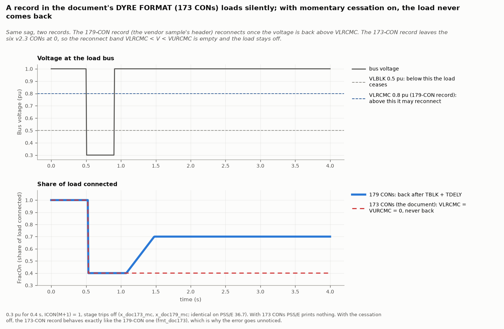

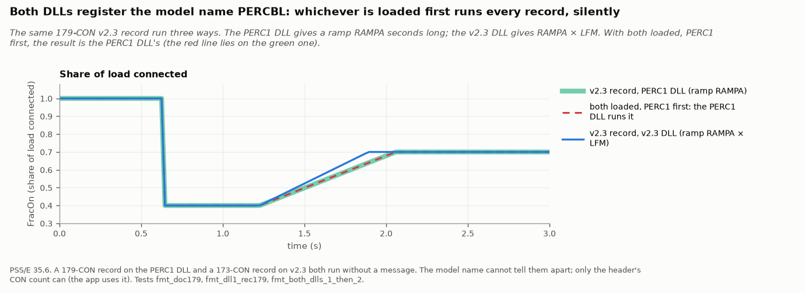

The header's CON count is the only thing that tells the two DLLs' records apart, which is how
the app routes them. A record with no ICON line switches momentary cessation on from unset
memory. With no DLL loaded, PSS/E prints a "not accessible" message once and then simulates
the load as zero.

### Ramps and the load factor

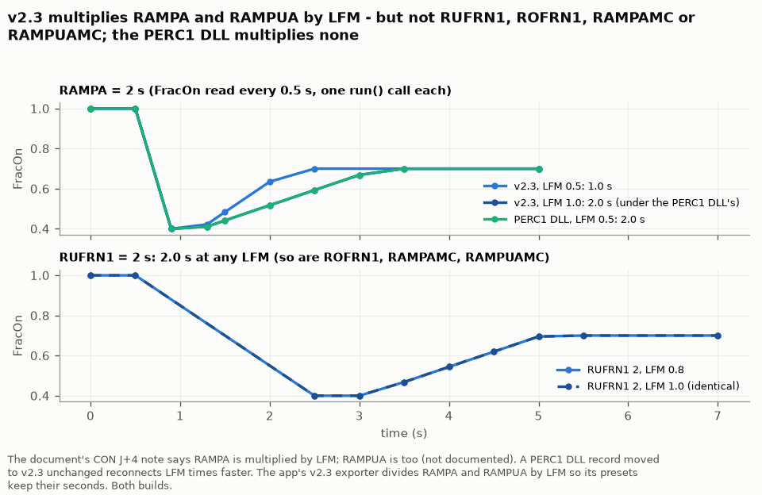

`RAMPA` and `RAMPUA` are stretched by the load factor (`LFM`): a 2 s ramp is 1.6 s at
`LFM` 0.8. `RUFRN1`, `ROFRN1`, `RAMPAMC` and `RAMPUAMC` are not. A PERC1 DLL record moved
to v2.3 unchanged therefore reconnects its voltage ramps 1.25 times faster at the usual
`LFM` of 0.8. The app divides both ramps by `LFM` so a preset keeps its seconds.

### Momentary cessation

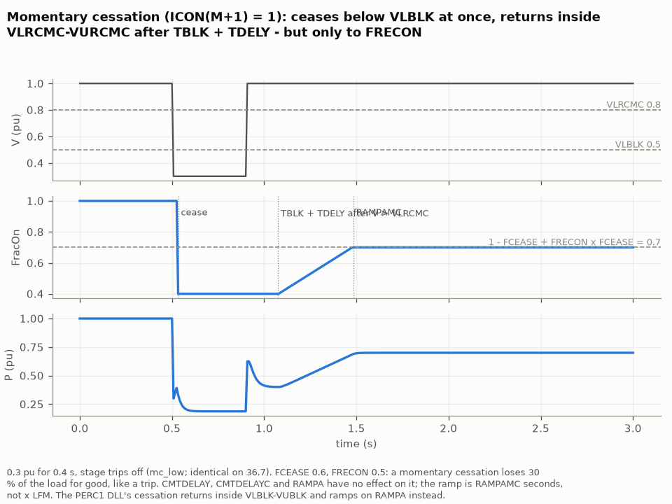

The load ceases at once when the filtered voltage is strictly below `VLBLK` (or above
`VUBLK`), with no delay, and returns after the voltage has been inside `VLRCMC` to `VURCMC`
for `TBLK` + `TDELY`. It ramps over `RAMPAMC` (or `RAMPUAMC`) to `1 - FCEASE + FRECON ×
FCEASE`, so with `FRECON` below 1 every cessation loses part of the load for good.

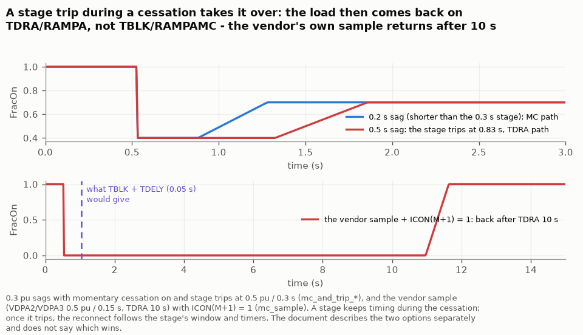

The stage timers keep running during a cessation. A stage that trips **takes the cessation
over**: the load then waits for the stage's reconnect window and `TDRA`. The vendor's sample
with momentary cessation on comes back after about 10 s, not the 0.05 s the cessation's own
settings suggest.

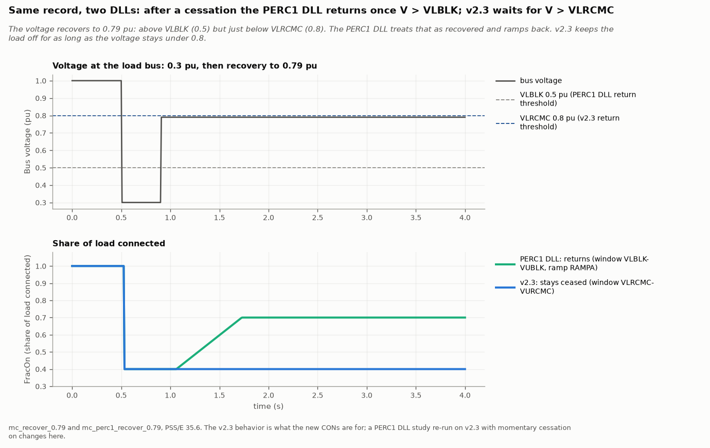

After a cessation the PERC1 DLL returns once the voltage is above `VLBLK`; v2.3 waits for
`VLRCMC`. A recovery to 0.79 pu reconnects on one and stays ceased on the other.

### The two builds

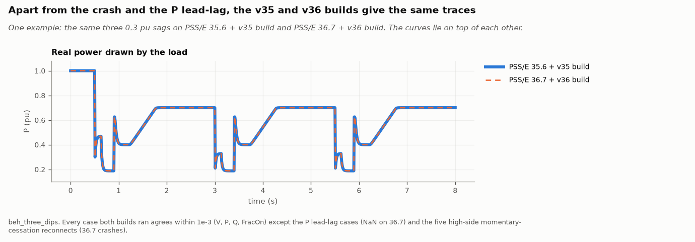

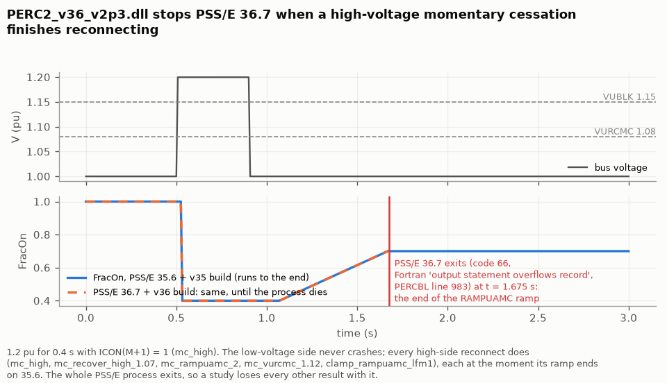

At the end of every high-voltage momentary-cessation ramp the v36 build stops the whole
PSS/E 36.7 process (Fortran runtime error, exit code 66). A study loses every result of the
run, not just this load, and the error appears only on the console. The low-voltage side never
crashes.

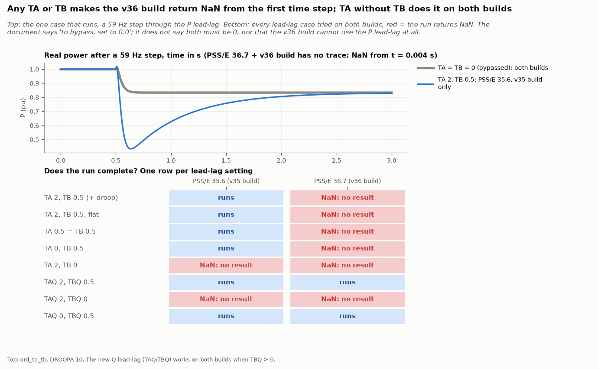

On the v36 build any non-zero `TA` or `TB` returns not-a-number from the first time step. The
reactive lead-lag (`TAQ`/`TBQ`) works on both builds when `TBQ` is above 0.

### Frequency base

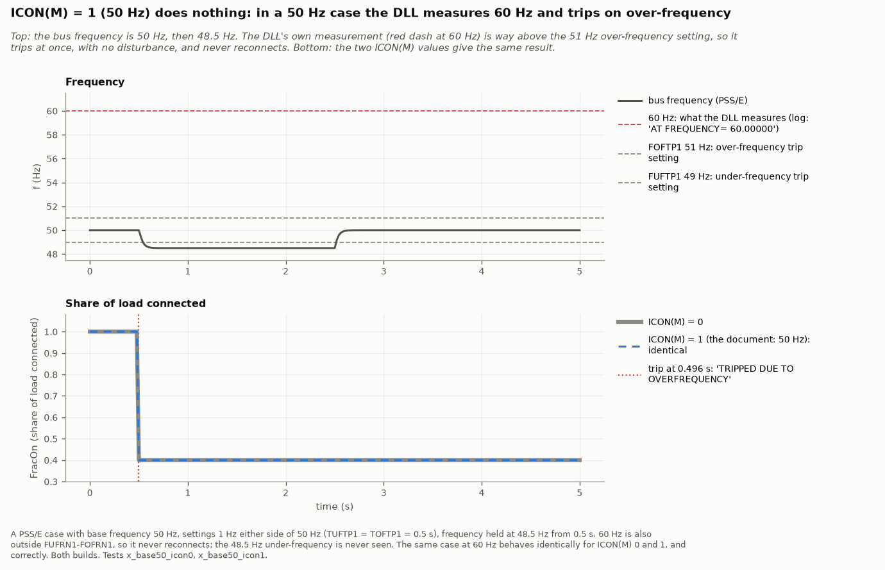

In a 50 Hz case the DLL trips on over-frequency with no disturbance, with `ICON(M)` at 0 or
1. It cannot be used in a 50 Hz system unless its frequency settings are written for 60 Hz ×
(f / 50).

### Out-of-range values

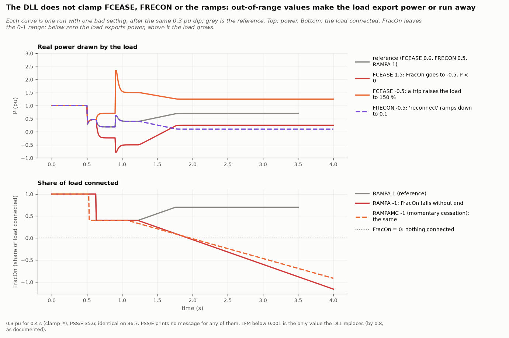

Only `LFM` below 0.001 is replaced (by 0.8). A `FCEASE` above 1 makes the load export power; a
negative `FCEASE` makes a trip raise the load to 150 %; a negative ramp runs `FracOn` below
zero and never stops; a reconnect window that excludes 1.0 pu never reconnects. None of these
produces a message.

## What the app does with this

- Records are written with the 179-CON header and routed on import by the header's CON count
  (173 reads as the PERC1 DLL, 179 as this model).
- Presets carry over from the PERC1 DLL's bundles CON for CON, with `RAMPA` and `RAMPUA`
  divided by `LFM`, `VRPA` capped at 0.95 pu (the five presets with 1.0 would never
  reconnect), momentary cessation off, and the four new cessation CONs at the vendor sample's
  values.
- The editor flags every hazard above: out-of-range `FCEASE`, `FRECON` and ramps; `TA`/`TB`
  and `TAQ`/`TBQ` that return not-a-number, and any `TA`/`TB` for PSS/E 36.7; `ICON(M)` set;
  the high-voltage crash with momentary cessation on; the permanent partial loss and the stage
  takeover; reconnect windows that exclude 1.0 pu; and cycling.

## Limits of this validation

- The two builds were run on one PSS/E version each (35.6.4 and 36.7.1). The PSS/E 34 build
  was not run.
- Dips to exactly 0 pu are excluded from the simulator comparison, because the test setup
  swells the bus to about 1.7 pu for 0.1 s after them.
- Out-of-range behavior was measured at the values listed, not swept.
- Results are for the builds tested; a later build of either DLL may behave differently.
