# PERC2 standard: validation results

PERC2 standard is Siemens' successor to PERC1 standard, built into PSS/E 36.7
(`PERCxx2U`). It needs no DLL. It has six on/off flags and 57 CONs: a momentary and a
four-point long cease for low and high voltage, each with its own reconnect delay and ramp, a
frequency cease, droop, voltage exponents and current limits with a total-current limit. See
the [model overview](model_overview.md) for how it compares with the others and the
[model reference](model_reference.md) for how presets map onto it.

| | |
|---|---|
| **PSS/E version validated** | 36.7.1. Built in, no DLL |
| **Needs** | a main-component record (`MAINxx10`) above it, as for PERC1 standard |
| **Record** | `USRLODC 'PERCxx2U' 230 IT 6 57 8 44 16 CompNum 'CompDesc'`, six flags, then 57 CONs |
| **PSS/E runs** | 443 cases |
| **Automatic checks** | 609 of 609 pass |
| **Reference** | Siemens' 13-page data sheet for the model (PSS/E 36.7.0) |

The PSS/E runs behind these counts are in the authors' PSS/E validation library, which is not published.

## How it was validated

The data sheet was tested line by line in PSS/E 36.7.1: the record, every flag and CON on its
own, the cease and reconnect machine, frequency, a one-machine network, and every preset the
app exports (all five record scopes, partial loads, a second component slot, and nine
presets for IT and VFD load, undervoltage and overvoltage). The same events were run on PERC1
standard and on the PERC1 DLL for comparison. The app's simulator reproduces PSS/E's
cease and reconnect sequence in every comparable case: events within 0.035 s and final
`FracOn` within 0.005.

## Results

| Question | Answer |
|---|---|
| **Does the sheet's record work?** | Yes. The record loads, initializes and responds. |
| **Is the order of the CONs right?** | Yes, all 57 CONs and 6 flags, each confirmed by its own effect. |
| **Does PSS/E do what the sheet says?** | Mostly. Seven statements are contradicted (below). |
| **Defects in PSS/E 36.7.1** | The third point of each long cease table uses the first point's time. |
| **Is it better than PERC1 standard?** | In two ways: its load fraction never collapses when a dip ends during `Tdelay` (PERC1 standard's does, and the network then returns not-a-number or a wrong load some of the time), and the reconnect timer restarts whenever the voltage leaves the window. |

### Where PSS/E departs from the data sheet

| Sheet | PSS/E 36.7.1 |
|---|---|
| The current-limit formulas of note 16 use max and min the wrong way round | The block diagram is right and the note is wrong: `IpmaxUsed` = min(`Ipmax`, `Imax`), and so on |
| Once the ramp starts, the model cannot cease until it ends | A second dip, a swell, a long point or a frequency cease all cease it again |
| `Ldfact` above 1 is reset to 0.8 | Used as given, with no message. Zero or less does fall back to 0.8 |
| `Tt` below twice the time step writes a message | Raised to twice the time step, with no message |
| A frequency cease sets `TrampUsed` to 9999 | 999; the load never reconnects either way (20 minutes tested) |
| Long-high point 3 compares `Vtf` < `VHC3` | A typo: it compares like the other high points |
| `TVLC4` is the point-4 voltage | A typo: it is the time; the voltage is `VLC4` |

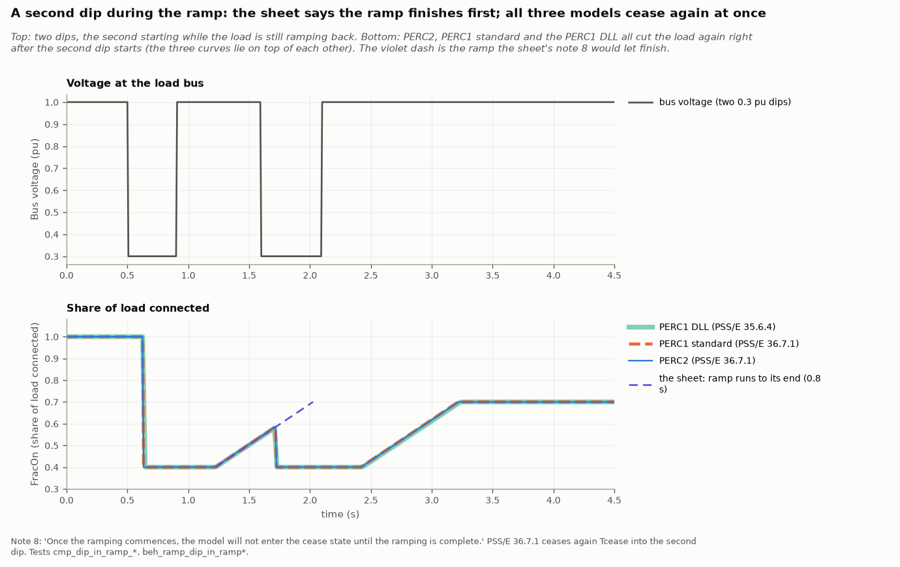

### The cease and reconnect cycle

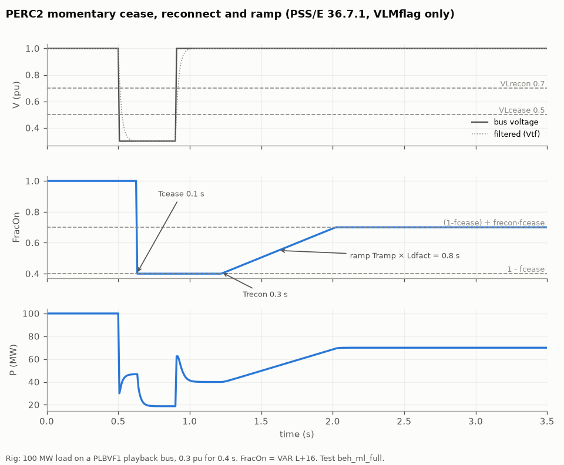

### Reconnecting

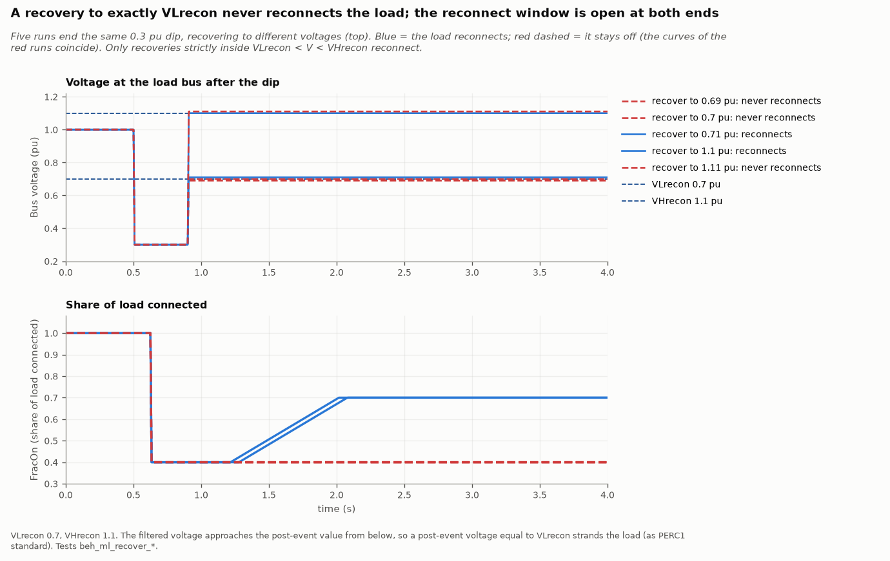

The reconnect window is strict on the filtered voltage, and the timer restarts whenever the
voltage leaves it. A recovery to exactly `VLrecon` strands the load, so presets cap `VLrecon`
at 0.95 pu.

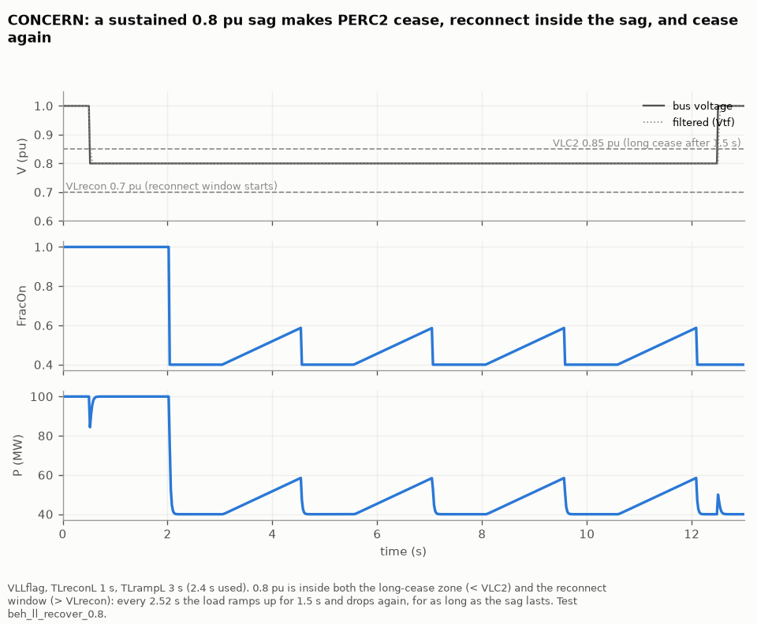

If a long-cease voltage is above `VLrecon`, a sag between the two makes the load cease,
reconnect and cease again for as long as it lasts. Presets raise `VLrecon` to their highest
long-cease voltage.

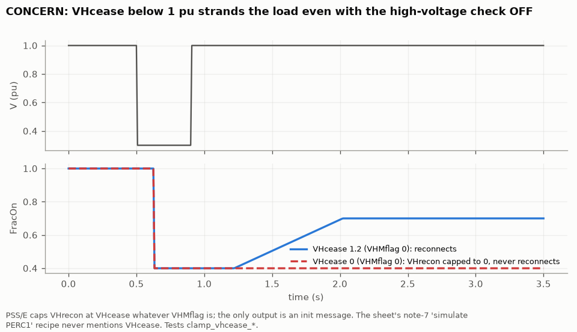

### Momentary and long cease

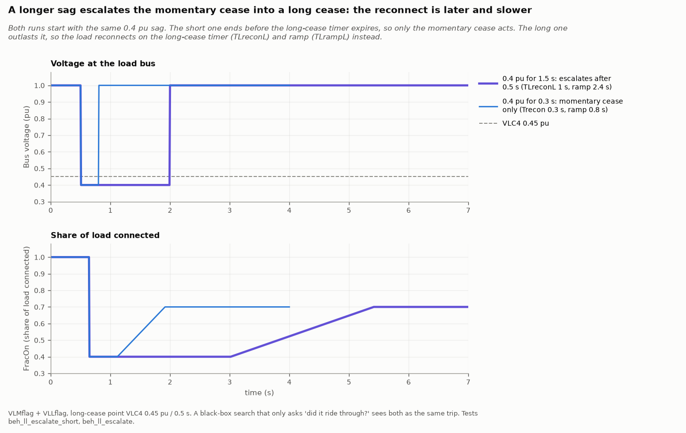

A sag shorter than the long-cease time reconnects through the momentary path. A longer sag
escalates to the long path, with its own, slower delay and ramp: the same sag, a different
outcome. A study that only asks "did the load ride through?" sees both as the same trip.

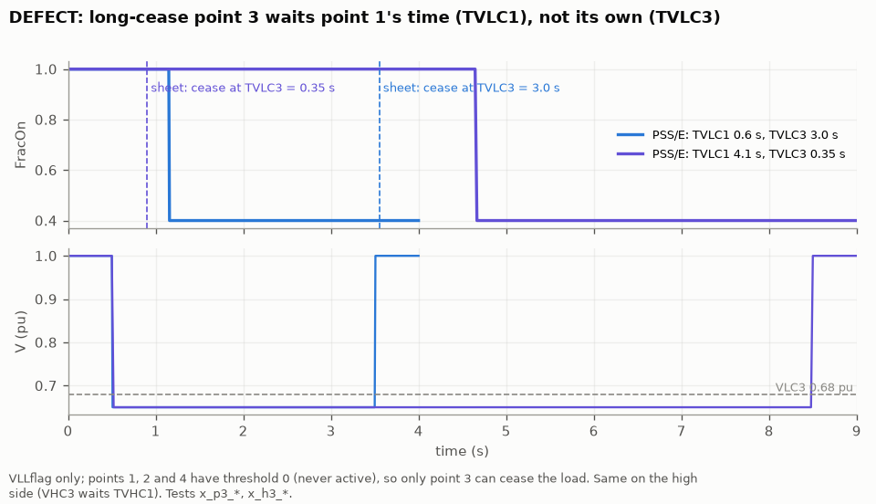

### Frequency

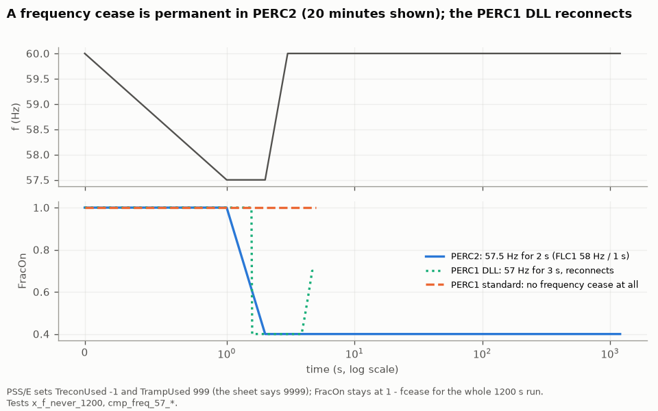

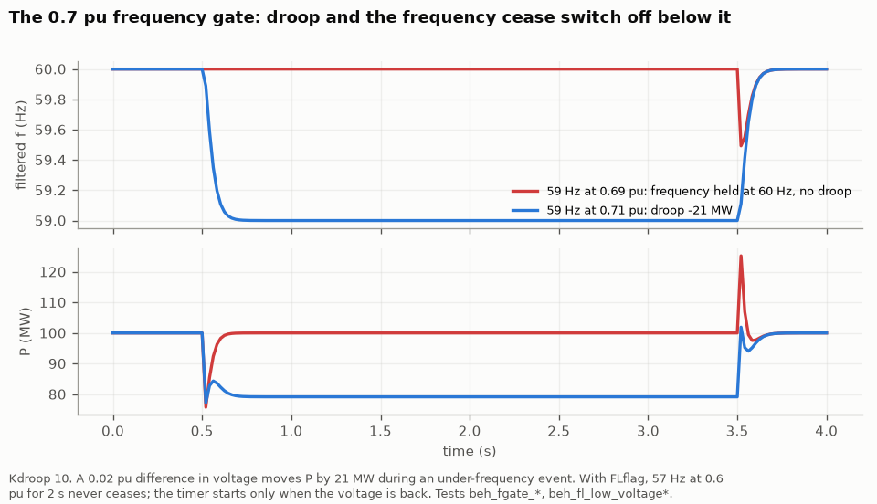

Droop and the frequency cease both stop while the bus voltage is below 0.7 pu.

### Load factor and not-a-number

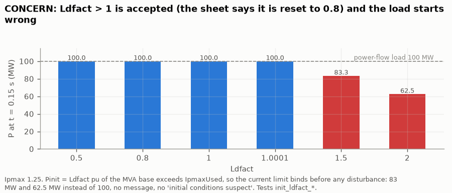

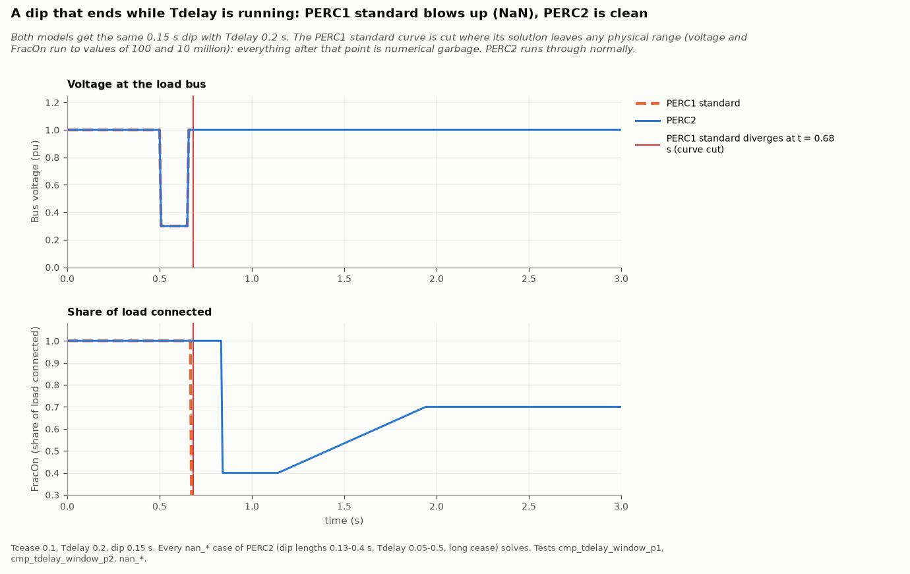

PERC2 never drops its load fraction when a dip ends during `Tdelay`: in all 14 such cases the
fraction stays at its cease level, in the original recording and in a rerun. PERC1 standard
drops it to almost zero every time, and what the network does next is intermittent (not-a-number
in 71 of 470 repeated runs, a wrong load in 12, normal in 387), so the plot shows one recorded
PERC1 standard run, not a certainty.

A voltage of exactly 0 pu still returns not-a-number, as in PERC1 standard.

### The three models on the same events

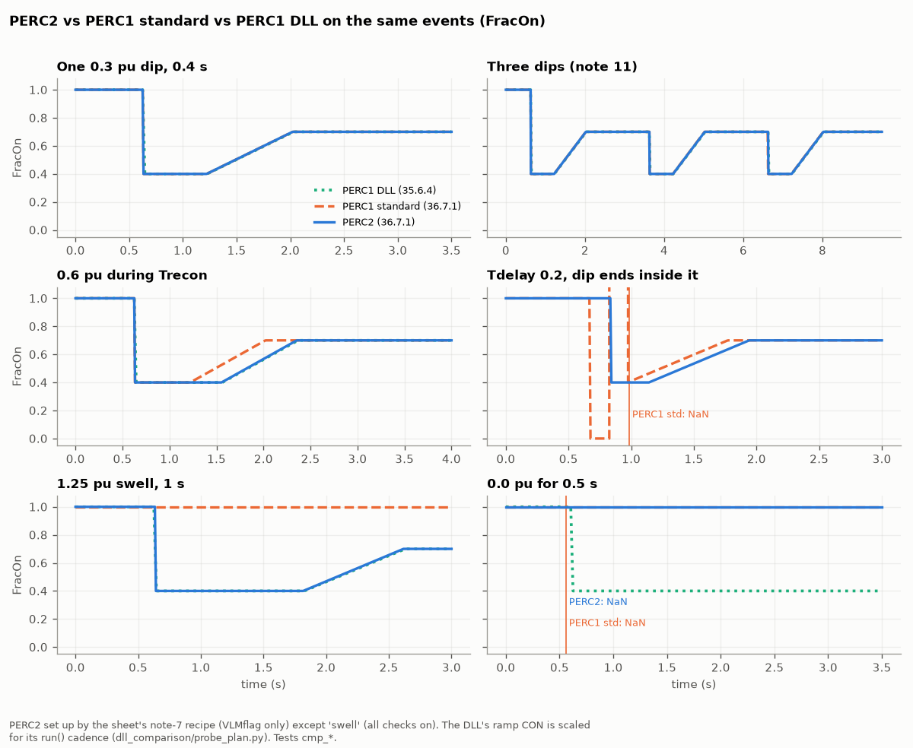

The sheet's recipe for reproducing PERC1 with PERC2 holds on the cease side: `FracOn` matches
PERC1 standard to one time step in every common scenario. It is not exact for a dip during
`Trecon`, and it omits `VHcease`, which must be at or above `VHrecon`.

## What the app does with this

- **Defaults** reproduce PERC1 standard's defaults through the sheet's recipe, with the other
  tables filled but switched off.
- **Presets** use their distinct undervoltage steps on long points 1, 2 and 4 (a fourth step
  on the momentary check), overvoltage steps on long-high points 1, 2 and 4, and frequency
  points from the preset. Point 3 is never used. `VLrecon` is set so they cannot cycle,
  and `Tramp` is the preset's ramp divided by `Ldfact`. Every preset passes the editor's
  checks and was run in PSS/E.
- Frequency points are permanent in this model, which the editor lists for presets whose
  standards expect the load to return.

## Limits of this validation

- PSS/E 36.7.1 only; the model is built into 36.7 and later.
- The data sheet is not yet part of Siemens' published model library, so the reference is the
  sheet itself.
- The PERC1 DLL side of the comparison ran on PSS/E 35.6.4.
