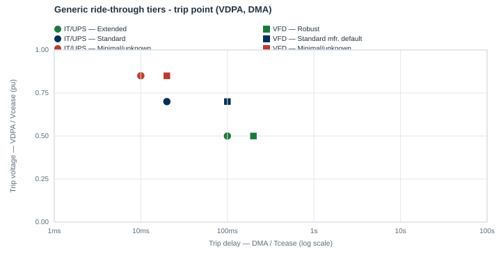
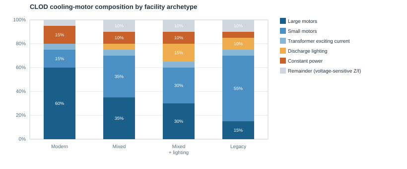

# Generic parameter tiers

This page explains the app's own engineering defaults for its power-electronic load models: the three
**generic ride-through tiers** and the **operating mode** selection that sets
the ZIP exponents. For the grid-operator presets (ERCOT, SPP, PJM, MISO, NERC), see the
[Preset library overview](presets/README.md).

Every value here is a starting point, not a measurement. Where you have
vendor or field data, enter it in **Post-Commissioning → Advanced
adjustments**.

## 1. Generic ride-through tiers

The first three entries in every **Ride-through preset** dropdown are
internal engineering tiers, not published standards. Each sets one trip
point (`VDPA`/`DMA`) that the model repeats into all four undervoltage
stages.

| Tier | `VDPA` (pu) | `DMA`, IT/UPS (s) | `DMA`, cooling VFD (s) | `VRPA` (pu) |
|---|---|---|---|---|
| **Extended** (ITI/CBEMA-plus) | 0.50 | 0.10 | 0.20 | 0.70 |
| **Standard** (ITIC/CBEMA) | 0.70 | 0.02 | 0.10 | 0.90 |
| **Minimal / unknown** | 0.85 | 0.01 | 0.02 | 0.95 |

**Why these values.**

- **Standard** sits at `VDPA = 0.70`, where the ITIC (CBEMA) equipment
  curve's 20-500 ms plateau lies. ITIC is used only as an anchor for
  "typical" equipment. The app never grades a block against ITIC; see
  [why not ITIC](presets/README.md#why-these-numbers-and-not-iticcbema).
- **Extended** trips at a deeper voltage (0.50 pu), for equipment rated
  better than ITIC or VFD cooling with kinetic ride-through.
- **Minimal / unknown** trips at a shallow voltage (0.85 pu). Use it when
  ride-through capability is genuinely unknown.
- **The cooling VFD block gets a longer delay** than IT/UPS at the same
  voltage, because motor inertia carries VFD-driven cooling through a sag
  slightly longer than IT electronics.
- **`VRPA = min(VDPA + 0.20, 0.95)`** puts the reconnect voltage above the
  trip voltage, so the block cannot trip and reconnect repeatedly at one
  voltage (see
  [Model behavior and limitations](model_behavior.md#if-vrpa-is-below-a-trip-stage-the-block-cycles)).

**Other values the three tiers share.**

| CON | Value | Meaning |
|---|---|---|
| `FCEASE` / `FRECON` | 1.00 / 1.00 | The whole block trips, and all of it reconnects |
| `TDRA` / `RAMPA` | 60 s / 30 s | Reconnect 60 s after voltage recovers, then ramp back over 30 s |
| `VDUA` / `TDUA` | 1.20 / 1.10 / 1.05 pu, 0.5 s | Overvoltage trip (Extended / Standard / Minimal) |
| `VRUPA` / `TRUPA` / `RAMPUA` | 1.05 pu / 5 s / 5 s | Overvoltage reconnect (vendor-typical values) |
| `IPMAXA` / `LFM` | 1.0 / 0.8 | Current limit and the block's power factor |
| `DROOPA` | 10 | Frequency droop on active power (vendor-typical) |
| `NPA` / `NQA` | 0 (Extended, Standard), 1 (Minimal) | Until an operating mode is chosen (section 2) |

The overvoltage settings of the generic tiers have no published source. They
were chosen to rank the three tiers consistently. Each tier's own page gives
the full CON table:
[Extended](presets/extended.md), [Standard](presets/standard_itic.md),
[Minimal](presets/minimal.md).

## 2. Operating mode → `NPA` / `NQA` (ZIP exponent)

In Post-Commissioning, each PERC1 block has an **Operating mode**: the UPS
type for the IT/UPS block, the front-end type for the cooling VFD block.
Choosing one sets both ZIP exponents, overriding the preset's value.

| Operating mode | `NPA` = `NQA` | Behavior in a sag |
|---|---|---|
| Double conversion (online) | 0 | Constant power |
| Active front-end (regenerative, near-unity PF) | 0 | Constant power |
| Eco-mode / line-interactive | 1 | Constant current |
| Direct-online (no UPS buffering) | 2 | Constant impedance |
| Standard front-end (diode rectifier) | 2 | Constant impedance |

**Why these values.** A tightly regulated front end (double-conversion UPS,
active-front-end VFD) holds its power draw constant through a sag until it
trips, so it is modeled as constant power (0). An unregulated front end draws
roughly fixed impedance, so its power falls with the square of voltage (2).
An eco-mode UPS regulates only part of the time, so it sits in between (1).

A constant-power block is still **current-limited** in PSS/E: below a
voltage of `LFM`/`IPMAXA` pu (0.80 pu for the generic tiers), its power falls
in proportion to voltage. See
[Model behavior and limitations](model_behavior.md#constant-power-blocks-are-current-limited).

## 3. Optional: conventional cooling motors (CLOD)

Only if a facility has conventional, non-VFD cooling motors does
Post-Commissioning add a PSS/E CLOD record for them. CLOD's trip and stall
behavior comes from fixed internal motor parameters, not from settings the
app chooses. What the app sets is the load's composition: large motors (`PC_LM`), small motors (`PC_SM`), transformer
exciting current (`PC_TX`), discharge lighting (`PC_DL`) and constant power
(`PC_CP`). The remainder is voltage-sensitive constant-impedance/current
load.

| Motor facility type | `PC_LM` | `PC_SM` | `PC_TX` | `PC_DL` | `PC_CP` | Remainder |
|---|---|---|---|---|---|---|
| Modern: large chillers, mostly VFD elsewhere, some fixed-speed backup | 60 | 15 | 5 | 0 | 15 | 5 |
| Mixed: moderate mix of large and small motors | 35 | 35 | 5 | 5 | 10 | 10 |
| Legacy: many small fixed-speed fan/pump motors, older CRAC units | 15 | 55 | 5 | 10 | 5 | 10 |

**Why these values.** The archetypes trade large-motor share for small-motor
share as a facility gets older and less centralized. Modern plants
concentrate cooling in a few large chillers, with more electronically
regulated auxiliaries. Legacy plants spread it over many small fixed-speed
motors, with more discharge lighting.

**Includes significant lighting / floor-space load** moves up to 10
percentage points from the two motor classes (in proportion) into
`PC_DL`.

