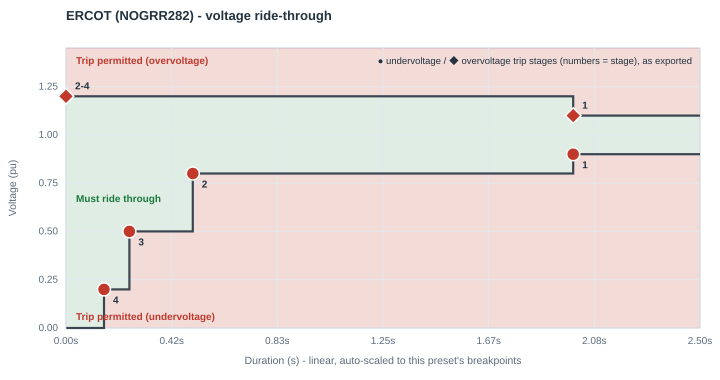
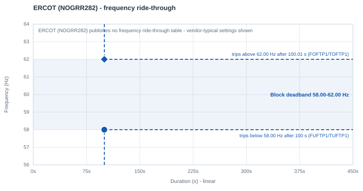

# ERCOT — NOGRR282

| | |
|---|---|
| **Preset ID** | `ercot_nogrr282` |
| **Category** | Grid operator standard |
| **Status** | **Adopted (PUCT-approved, final)** |
| **Primary source** | ERCOT NOGRR282, "Large Electronic Load Ride-Through Requirements," Nodal Operating Guide §2.14, Table A — filed Nov 14, 2025 |

## Summary

ERCOT's ride-through requirement for **Large Electronic Loads (LELs)** —
large, power-electronics-interfaced loads such as data centers, crypto-mining
facilities, and similar. This is the most mature/adopted grid-operator
standard in this app's library: final, PUCT-approved Nodal Operating Guide
language, not a proposal or draft.

## Primary source

Read directly from the filed guide-language document (`282NOGRR-01-Large-
Electronic-Load-Ride-Through-Requirements-111425.docx`, ERCOT, filed Nov 14,
2025 — Nodal Operating Guide §2.14, Table A), not a secondary chart or
summary slide. A widely-circulated industry comparison deck (PJM Planning
Committee, "PJM LCL Ride-through Requirements," Sep 8, 2026, slide 9)
summarizes this same requirement, but its summary of ERCOT's curve turns out
to **mislabel two values** — the deepest voltage tier as "0.35 pu" (the
filed text is unambiguous: "V < 0.20") and the overcurrent cap as "150%" (the
filed text says 125%). This app's numbers are transcribed from ERCOT's own
filed text and are correct where they differ from that summary slide.

## Ride-through envelope

### Undervoltage (sag) floor

| Below this voltage (pu) | Must ride through for at least |
|---|---|
| 0.20 | 0.15 s |
| 0.50 | 0.25 s |
| 0.80 | 0.50 s |
| 0.90 | 2.00 s |
| *(continuous above 0.90 pu, up to 1.10 pu)* | — |

### Overvoltage (swell) ceiling

| Up to this voltage (pu) | Must tolerate for at least |
|---|---|
| 1.10 | continuous (0.90 ≤ V ≤ 1.10 pu is the continuous band) |
| 1.20 | 2.0 s |
| *(above 1.20 pu)* | may ride through or trip |

## Overcurrent limit

**125%** of maximum current consumption during normal operation, during any
disturbance outside the continuous operating band. (Not 150% — see the
mislabeling note above.)

## Post-disturbance recovery requirement

May reduce active power for V < 0.8 pu, proportional to the voltage drop
(per a phase-in schedule through Jan 1, 2028 — the 0.50-0.80 pu band's
proportional-reduction allowance is capped, not fully unrestricted, for LELs
approved on or before that date; fully unrestricted proportional reduction
applies only to LELs approved after it). Must restore ≥90% of pre-disturbance
active power within **1 s** of voltage returning above 0.9 pu.

## Reconnection behavior (trip fraction, reconnect fraction, timing)

- **Trip fraction (`FCEASE`)** — **Not standardized as a discrete fraction.**
  ERCOT's own language describes continuous, voltage-proportional curtailment
  ("may reduce active power... proportional to the voltage drop"), not a
  fixed "X% of the facility disconnects" figure. PERC1's Option 1
  cease/reconnect logic is binary — a block either ceases `FCEASE` of its
  load below `Vcease` or it doesn't — so it cannot reproduce ERCOT's
  proportional-curtailment allowance directly. `FCEASE=1.00` (full cease
  below `VDPA`) is this app's binary approximation, not an ERCOT-published
  number — see "Known caveats" below.
- **Reconnect fraction (`FRECON`)** — Not separately specified. ERCOT's
  "restore ≥90%..." clause describes an interim checkpoint on the way back
  to full pre-disturbance consumption, not a permanent partial-reconnect
  ceiling. `FRECON=1.00` (full reconnect) is this app's default.
- **Reconnect delay (`TDRA`/Trecon)** — Not separately specified — ERCOT's
  text gives one combined 1.0 s restoration window, not a "confirm, then
  ramp" split. This app allocates `TDRA=0.917 s` of that window as a
  confirmation dwell (guards against re-triggering on a bouncing voltage
  signal), with the remainder spent on the actual ramp (next row) — see the
  library-wide convention in [the index README](README.md#trip-fraction-reconnect-fraction-and-reconnect-timing-fceasefrecontdrarampa).
- **Ramp rate (`RAMPA`/Tramp)** — **Standardized total, app-derived split.**
  ERCOT requires ≥90% of pre-disturbance power restored within 1.0 s of
  voltage recovering above 0.9 pu. Rather than modeling that entire second
  as one slow linear power ramp, this app sets `RAMPA=0.083 s` (5 cycles —
  borrowed from SPP's own published fast-recovery figure, the one standard
  in this library that specifies a directly plausible power-electronics
  ramp rate) as the actual ramp, spending the rest of the window
  (`TDRA=0.917 s`) as a confirmation dwell first. The combined total
  (`TDRA+RAMPA=1.0 s`) still reaches 100% restored by ERCOT's own deadline —
  conservative (at least as fast as required), never slower.

## Applicability

Applies to Large Electronic Loads. Not retroactive: facilities operational,
or with signed interconnection agreements, before Nov 14, 2025 are exempt
(though incentivized to comply anyway).

## Frequency ride-through

PJM's comparison deck (slide 16) summarizes ERCOT's frequency ride-through as asymmetric - a **58.8 Hz low-side and 61.8 Hz high-side** threshold - without durations, and the filed NOGRR282 text this preset is transcribed from is voltage-only. Not encoded. The block keeps PERC1's vendor-typical frequency settings: a **58.0-62.0 Hz deadband**, tripping after 100 s outside it (`FUFTP1/TUFTP1 = 58.0 Hz / 100 s`, `FOFTP1/TOFTP1 = 62.0 Hz / 100.01 s`). If the facility's actual under/over-frequency protection is known, set the deadband in the block's **Frequency ride-through** row.

PERC1 has one frequency trip point per direction, so the block's frequency behavior is a **deadband**: it rides through indefinitely between `FUFTP1` and `FOFTP1`, and trips once frequency has been outside that band for `TUFTP1`/`TOFTP1`.

## Plots

### Voltage ride-through

Every exported trip stage is marked - ● undervoltage, ◆ overvoltage; the numbers are stage numbers, grouped where stages share a point.

### Frequency ride-through

The shaded blue band is the block's frequency deadband, with its two trip points (● under-frequency, ◆ over-frequency); red/green shading is the standard's own table where it publishes one.

## How this maps to the exported PERC1 CONs

ERCOT's own table has 5 undervoltage rows (4 mandatory trip tiers plus the
continuous-operation floor) and PERC1's Option-3 stepped trip table has
exactly 4 stages per direction — a precise, not approximate, fit. This
preset exports **all 4 undervoltage stages**, reproducing
ERCOT's own Table A exactly (see the
[index README](README.md#how-a-multi-tier-standard-becomes-a-full-multi-stage-psse-con-table); PSS/E testing confirmed that the model always evaluates
all four stages):

| Stage | Voltage (pu) | Duration (s) | CON pair |
|---|---|---|---|
| 1 (Option 1's own point) | 0.90 | 2.00 | `VDPA`/`DMA` |
| 2 | 0.80 | 0.50 | `VDPA1`/`DMA1` |
| 3 | 0.50 | 0.25 | `VDPA2`/`DMA2` |
| 4 | 0.20 | 0.15 | `VDPA3`/`DMA3` |

This is a precise reproduction of ERCOT's own multi-row table, not a
conservative single-point approximation of it, confirmed in PSS/E (see
[Model behavior and limitations](../model_behavior.md#the-multi-stage-trip-table-works-as-published)). The overvoltage
side has two real published setpoints: the continuous ceiling (`1.10 pu`)
and the mandatory tier (`1.20 pu / 2.00 s`). Read literally, "up to 1.20 pu:
must tolerate for at least 2.0 s" describes the whole band *above* the
continuous ceiling, not a threshold that only starts mattering once V
reaches 1.20 pu - so a swell anywhere over 1.10 pu can trip after the
published 2.0 s (it cannot ride through 1.15 pu indefinitely). ERCOT's own
text is then explicit and literal that anything past the mandatory tier's
own voltage is undefined: "above 1.20 pu: may ride through or trip" - so a
swell over 1.20 pu can trip essentially immediately, regardless of how long
it's held. Both setpoints (1.10 and 1.20) are ERCOT's own published numbers
- no intermediate voltage is invented. PERC1's `VDUA`/`TDUA` mechanism is a
simple "trip if V exceeds VDUA for TDUA seconds" timer, so reproducing the
1.10-1.20 pu band correctly means arming stage 1 at the band's own lower
edge (1.10 pu), not at its upper edge (1.20 pu):

| Stage | Voltage (pu) | Duration (s) | CON pair |
|---|---|---|---|
| 1 (arms above the continuous ceiling) | 1.10 | 2.00 | `VDUA`/`TDUA` |
| 2 (arms above the published tier - immediate trip) | 1.20 | 0.0 | `VDUA1`/`TDUA1` |
| 3 | 1.20 | 0.0 | `VDUA2`/`TDUA2` |
| 4 | 1.20 | 0.0 | `VDUA3`/`TDUA3` |

See [the index README](README.md#how-a-multi-tier-standard-becomes-a-full-multi-stage-psse-con-table)
for why. Each stage times independently in PSS/E, and each stage's arming
voltage is chosen so the resulting trip behavior matches ERCOT's published
band exactly. The live chart's ride-through panel grades every stage against
the same envelope.

| CON | IT/UPS block | Cooling VFD block | Why they differ |
|---|---|---|---|
| `VDPA` (Vcease) | 0.90 pu | 0.90 pu | same — ERCOT's own shallowest mandatory row |
| `DMA` (Tcease) | 2.00 s | 2.00 s | same |
| `VRPA` (Vrecon) | 1.00 pu | 1.00 pu | this preset's own reconnect-voltage setting, chosen inside ERCOT's own continuous operating band (0.90-1.10 pu) rather than via the generic `min(VDPA+0.20, 0.95)` formula the three internal tiers use |
| `VDUA` (high-voltage trip) | 1.10 pu | 1.10 pu | ERCOT's own continuous-ceiling boundary - the band above it (up to 1.20 pu) is where the 2.0 s mandatory tolerance applies |
| `TDUA` | 2.00 s | 2.00 s | ERCOT's own 2.0 s minimum ride-through for the 1.10-1.20 pu band |
| `FCEASE` / `FRECON` | 1.00 / 1.00 | 1.00 / 1.00 | app default (binary approximation of ERCOT's proportional-curtailment allowance) — see "Reconnection behavior" above |
| `TDRA` (Trecon) | 0.917 s | 0.917 s | app-derived split — ERCOT's own 1.0 s window minus this app's ramp-rate benchmark |
| `RAMPA` (Tramp) | **0.083 s** | **0.083 s** | **standardized total (1.0 s), app-derived split** — this app's realistic power-electronics ramp benchmark (see "Reconnection behavior" above) |
| `NPA` / `NQA` (ZIP exponent) | 0 / 0 (constant power) | 0 / 0 | |
| `IPMAXA` | **1.25 pu** | **1.25 pu** | ERCOT's own 125% overcurrent cap — the one preset in this library where `IPMAXA` is driven directly from a standard's own number rather than left at this app's neutral 1.0 pu default |

## Known caveats / limitations

- **`VRPA = 1.00` usually means "does not reconnect" in PSS/E.** The model
  reconnects only while the filtered voltage is strictly between `VRPA` and
  `VRUPA` (1.00-1.05 pu here). After a fault, a load bus usually settles a
  little below 1.00 pu, and the block then stays tripped, as the live
  chart also shows. For a study, consider `VRPA`
  0.90-0.95 pu (not below the highest undervoltage stage). See
  [Model behavior and limitations](../model_behavior.md#reconnection-needs-the-voltage-inside-a-window).
- **`DROOPA = 10` (vendor-typical) changes load by 16.7% per Hz** during
  frequency events (the live chart's frequency event shows it). See
  [frequency droop](../model_behavior.md#frequency-droop-is-large-and-always-on).
- **The 0.50-0.80 pu proportional-reduction phase-in (through Jan 1, 2028) is
  not modeled as a date-aware toggle** — this preset ships with the
  fully-enforced numbers. This makes the modeled behavior *more* conservative
  than what's strictly required before that date, not less, so it is not an
  under-protective simplification.
- **Known, real (non-error) deviation from ITIC** (informational, since this
  app no longer compares against ITIC anywhere — see the index README):
  because ERCOT's continuous-band floor (0.90 pu) takes effect at t = 2.0 s,
  while ITIC's rises to 0.90 pu only at t = 10 s, ERCOT's curve is *laxer*
  than ITIC's for the narrow 2-10 s window. This is a real, independently
  reproducible property of ERCOT's own filed Table A, not a transcription
  artifact, and the same pattern recurs in SPP's and MISO's own published
  curves.
- Re-verified directly against the filed guide-language text (not a
  secondary/summary chart) specifically because an earlier revision of this
  preset, sourced from a conference slide summary, had **both** the deepest
  voltage tier and the overcurrent cap wrong (see "Primary source" above).
- **`FCEASE=1.00` is a binary stand-in for ERCOT's continuous
  proportional-curtailment allowance**, not a modeling error — see
  "Reconnection behavior" above. PERC1 Option 1 has no CON that represents
  "power reduces proportionally with voltage depth"; only the discrete
  `VDPA`/`DMA` cease point and the `IPMAXA` current cap are available, both
  of which this preset already sets from ERCOT's own numbers.
