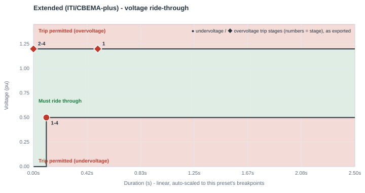
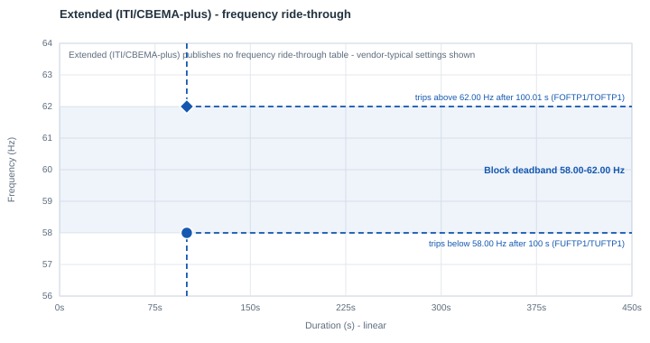

# Extended (ITI/CBEMA-plus)

| | |
|---|---|
| **Preset ID** | `extended` |
| **Category** | Generic (internal engineering tier, not a grid-operator standard) |
| **Status** | Adopted (internal) |
| **Primary source** | Internal engineering tiering — [Generic parameter tiers](../parameter_tiers.md#1-generic-ride-through-tiers) |

## Summary

Represents equipment explicitly rated for ride-through performance better
than the ITIC/CBEMA curve — e.g. UPS/IT hardware rated "ITI-plus," or
VFD-driven cooling with genuine kinetic-buffering ride-through (rotating
inertia that keeps the motor turning through a sag without external power).
This is the most tolerant of the three generic tiers and is a reasonable
starting point when a facility's actual equipment ride-through spec is
better than typical, but has not yet been reduced to a vendor spec sheet or
field-confirmed setting.

This is **not** a grid-operator or reliability-standard requirement — it is
this app's own internal engineering judgment call about what "better than
standard" equipment looks like, used as a starting point pending real vendor or field data.

## Ride-through envelope

### Undervoltage (sag) floor

| Below this voltage (pu) | Must ride through for at least |
|---|---|
| 0.50 | 0.10 s |
| *(continuous above 0.50 pu)* | — |

### Overvoltage (swell) ceiling

| Up to this voltage (pu) | Must tolerate for at least |
|---|---|
| 1.20 | continuous (no published finite tier) |

No grid-operator-style temporal overvoltage table exists for this internal
tier — the ceiling is simply set higher than the other two generic tiers
(1.20 pu vs. Standard's 1.10 / Minimal's 1.05), reflecting the same "more
tolerant" intent as the undervoltage side.

## Overcurrent limit

Not specified (no `IPMAXA` override; uses the model's neutral 1.0 pu
default — see the README's `IPMAXA` note).

## Post-disturbance recovery requirement

Not applicable — this is a single-point internal tier, not a standard with
its own recovery-timing language.

## Frequency ride-through

None - this internal tier is voltage-only. The block keeps PERC1's vendor-typical frequency settings: a **58.0-62.0 Hz deadband**, tripping after 100 s outside it (`FUFTP1/TUFTP1 = 58.0 Hz / 100 s`, `FOFTP1/TOFTP1 = 62.0 Hz / 100.01 s`). If the facility's actual under/over-frequency protection is known, set the deadband in the block's **Frequency ride-through** row.

PERC1 has one frequency trip point per direction, so the block's frequency behavior is a **deadband**: it rides through indefinitely between `FUFTP1` and `FOFTP1`, and trips once frequency has been outside that band for `TUFTP1`/`TOFTP1`.

## Plots

### Voltage ride-through

Every exported trip stage is marked - ● undervoltage, ◆ overvoltage; the numbers are stage numbers, grouped where stages share a point.

### Frequency ride-through

The shaded blue band is the block's frequency deadband, with its two trip points (● under-frequency, ◆ over-frequency); red/green shading is the standard's own table where it publishes one.

The plot's exported point sits exactly on the published breakpoint here,
since this tier has only one undervoltage row and no finite overvoltage
row — there is nothing to collapse.

## How this maps to the exported PERC1 CONs

| CON | IT/UPS block | Cooling VFD block | Why they differ |
|---|---|---|---|
| `VDPA` (Vcease) | 0.50 pu | 0.50 pu | same |
| `DMA` (Tcease) | 0.10 s | 0.20 s | VFD-driven cooling motors carry rotating inertia/kinetic energy that lets them coast through a sag slightly longer than IT/UPS electronics before the block needs to shed load — a real physical difference, not an arbitrary offset |
| `VRPA` (Vrecon) | 0.70 pu | 0.70 pu | `min(VDPA + 0.20, 0.95)` — hysteresis above the trip point so the block doesn't chatter right at the threshold |
| `VDUA` (high-voltage trip) | 1.20 pu | 1.20 pu | same |
| `TDUA` | 0.50 s | 0.50 s | same — chosen for plotting/export purposes; no published temporal figure exists for this internal tier's overvoltage side |
| `FCEASE` / `FRECON` | 1.00 / 1.00 | 1.00 / 1.00 | full trip, full reconnect |
| `NPA` / `NQA` (ZIP exponent) | 0 / 0 (constant power) | 0 / 0 | this tier assumes constant-power behavior during a disturbance |
| `IPMAXA` | 1.0 pu | 1.0 pu | this app's own neutral default, not a vendor/standard mandate |

## Known caveats / limitations

- This is an internal engineering placeholder, explicitly labeled
  a placeholder in the app's report until an engineer
  overrides it with vendor/spec-sheet or field-validated data.
- The overvoltage ceiling (1.20 pu) and its `TDUA` (0.50 s) have no published
  source — they were chosen to be consistent with, and more tolerant than,
  the Standard tier's own generic ceiling, not derived from any equipment
  spec or standard.
