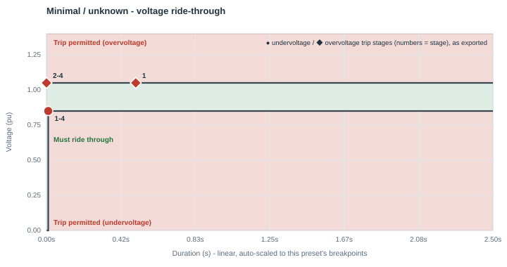
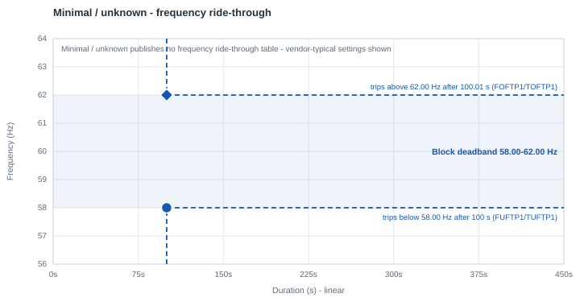

# Minimal / unknown

| | |
|---|---|
| **Preset ID** | `minimal` |
| **Category** | Generic (internal engineering tier, not a grid-operator standard) |
| **Status** | Adopted (internal) |
| **Primary source** | Internal engineering tiering — [Generic parameter tiers](../parameter_tiers.md#1-generic-ride-through-tiers) |

## Summary

The conservative default for a block whose actual ride-through capability is
genuinely unknown, or known to be poor (e.g. older/legacy UPS or VFD hardware
with no ride-through rating at all). This tier assumes the block trips on
sags that ITIC-class equipment would ride through — deliberately pessimistic,
so that "I don't know" defaults to the assumption most likely to be safe for
planning purposes (a facility that turns out to ride through better than
this is a pleasant surprise; one modeled as more tolerant than it really is
would not be).

This is **not** a grid-operator or reliability-standard requirement — it is
this app's own internal engineering judgment call, used as a starting point pending real vendor or field data.

## Ride-through envelope

### Undervoltage (sag) floor

| Below this voltage (pu) | Must ride through for at least |
|---|---|
| 0.85 | 0.01 s |
| *(continuous above 0.85 pu)* | — |

### Overvoltage (swell) ceiling

| Up to this voltage (pu) | Must tolerate for at least |
|---|---|
| 1.05 | continuous (no published finite tier) |

This is the tightest (least tolerant) ceiling of the three generic tiers,
consistent with the same "assume the worst" intent as the undervoltage side.

## Overcurrent limit

Not specified (uses the model's neutral 1.0 pu `IPMAXA` default).

## Post-disturbance recovery requirement

Not applicable — a single-point internal tier, not a standard with its own
recovery-timing language.

## Frequency ride-through

None - this internal tier is voltage-only. The block keeps PERC1's vendor-typical frequency settings: a **58.0-62.0 Hz deadband**, tripping after 100 s outside it (`FUFTP1/TUFTP1 = 58.0 Hz / 100 s`, `FOFTP1/TOFTP1 = 62.0 Hz / 100.01 s`). If the facility's actual under/over-frequency protection is known, set the deadband in the block's **Frequency ride-through** row.

PERC1 has one frequency trip point per direction, so the block's frequency behavior is a **deadband**: it rides through indefinitely between `FUFTP1` and `FOFTP1`, and trips once frequency has been outside that band for `TUFTP1`/`TOFTP1`.

## Plots

### Voltage ride-through

Every exported trip stage is marked - ● undervoltage, ◆ overvoltage; the numbers are stage numbers, grouped where stages share a point.

### Frequency ride-through

The shaded blue band is the block's frequency deadband, with its two trip points (● under-frequency, ◆ over-frequency); red/green shading is the standard's own table where it publishes one.

## How this maps to the exported PERC1 CONs

| CON | IT/UPS block | Cooling VFD block | Why they differ |
|---|---|---|---|
| `VDPA` (Vcease) | 0.85 pu | 0.85 pu | same |
| `DMA` (Tcease) | 0.01 s | 0.02 s | VFD-driven cooling motors carry rotating inertia that lets them coast through a sag slightly longer before shedding load, even in the "minimal" case |
| `VRPA` (Vrecon) | 0.95 pu | 0.95 pu | `min(VDPA + 0.20, 0.95)` — capped at 0.95 pu here since `VDPA + 0.20` would otherwise exceed it |
| `VDUA` (high-voltage trip) | 1.05 pu | 1.05 pu | same |
| `TDUA` | 0.50 s | 0.50 s | chosen for plotting/export purposes; no published temporal figure for this tier's overvoltage side |
| `FCEASE` / `FRECON` | 1.00 / 1.00 | 1.00 / 1.00 | full trip, full reconnect |
| `NPA` / `NQA` (ZIP exponent) | 1 / 1 (constant current) | 1 / 1 | this tier assumes constant-current behavior, unlike the other two generic tiers' constant-power assumption — a conservative choice consistent with older/unrated equipment |
| `IPMAXA` | 1.0 pu | 1.0 pu | this app's own neutral default, not a vendor/standard mandate |

## Known caveats / limitations

- This is an internal engineering placeholder, explicitly labeled
  a placeholder in the app's report until overridden with
  vendor/spec-sheet or field-validated data.
- Because this tier is deliberately conservative, it should not be
  interpreted as "this is what old equipment actually does" — it is a
  planning-safe assumption for when the real answer isn't known yet.
