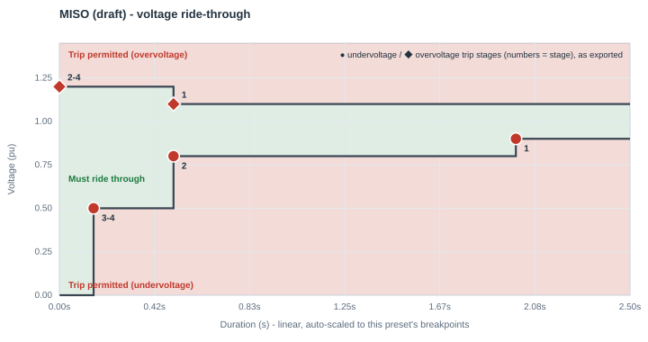
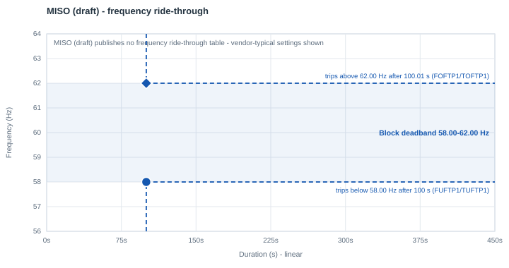

# MISO — draft voltage ride-through envelope

| | |
|---|---|
| **Preset ID** | `miso_draft` |
| **Category** | Grid operator standard |
| **Status** | Draft — **not finalized** |
| **Primary source** | MISO Voltage Ride-through Envelope (draft), as reproduced in PJM Planning Committee, "PJM LCL Ride-through Requirements" (Sep 8, 2026), slide 11 |

## Summary

MISO's own draft voltage ride-through requirement, as reproduced on PJM's
comparison slide. MISO has not finalized this — the "draft" label is MISO's
own, as reproduced on that slide.

## Primary source

Re-verified by tracing the slide's own vector-drawn curve coordinates
(`pdfplumber`'s `page.lines`, not OCR/pixel-reading or axis-tick text alone).
This mattered here specifically: an earlier revision of this preset
misattributed a second breakpoint to MISO that its own chart does not
have — see "Known caveats" below.

## Ride-through envelope

### Undervoltage (sag) floor

| Below this voltage (pu) | Must ride through for at least |
|---|---|
| 0.50 | 0.15 s |
| 0.80 | 0.50 s |
| 0.90 | 2.00 s |
| *(continuous above 0.90 pu, up to 1.10 pu, no power reduction permitted)* | — |

MISO's chart states its continuous band more strictly than ERCOT's/PJM's
"consume P at pre-disturbance level" phrasing — MISO's own text says no
power reduction is permitted at all in this band, which is functionally
equivalent for this app's purposes.

### Overvoltage (swell) ceiling

| Up to this voltage (pu) | Must tolerate for at least |
|---|---|
| 1.10 | continuous |
| 1.20 | 0.5 s |

## Overcurrent limit

Not specified in the source slide.

## Post-disturbance recovery requirement

In the 0.50-0.90 pu "Proportional Reduction & Mandatory Recovery" band, may
reduce active power in proportion to the voltage deviation, but must return
to ≥90% of pre-disturbance level within **1 second** of voltage recovering
above 0.9 pu — a shorter (stricter) recovery window than ERCOT's/PJM's 1-2 s
— "unless studies demonstrate that a slower recovery is necessary to
maintain BES reliability," in which case that longer recovery is the default
expectation per MISO's own text.

## Reconnection behavior (trip fraction, reconnect fraction, timing)

- **Trip fraction (`FCEASE`)** — **Not standardized as a discrete fraction.**
  MISO's own language describes continuous proportional reduction, not a
  fixed trip fraction. `FCEASE=1.00` is this app's binary approximation
  (same reasoning as ERCOT's/PJM's presets), not a MISO-published number.
- **Reconnect fraction (`FRECON`)** — Not separately specified. `FRECON=1.00`
  (full reconnect) is this app's default.
- **Reconnect delay (`TDRA`/Trecon)** — Not separately specified — MISO's
  text gives one combined 1.0 s recovery window, not a "confirm, then ramp"
  split. This app allocates `TDRA=0.917 s` of that window as a confirmation
  dwell, with the remainder spent on the actual ramp (next row) — see the
  library-wide convention in [the index README](README.md#trip-fraction-reconnect-fraction-and-reconnect-timing-fceasefrecontdrarampa).
- **Ramp rate (`RAMPA`/Tramp)** — **Standardized total, app-derived split.**
  MISO requires ≥90% of pre-disturbance power restored within 1.0 s of
  voltage recovering above 0.9 pu (MISO's own stricter alternative —
  "unless studies demonstrate a slower recovery is necessary" — is not
  modeled; this preset uses MISO's default 1.0 s figure). Rather than
  modeling that entire second as one slow linear power ramp, this app sets
  `RAMPA=0.083 s` (5 cycles — borrowed from SPP's own published
  fast-recovery figure) as the actual ramp, spending the rest of the window
  (`TDRA=0.917 s`) as a confirmation dwell first. The combined total
  (`TDRA+RAMPA=1.0 s`) still reaches 100% restored by MISO's own deadline —
  conservative, never slower than required.

## Frequency ride-through

Per the same source deck (slide 16), MISO's under/over-frequency ride-through band is **57.5-61.2 Hz**, referencing PRC-029-1/IEEE 2800. The deck gives the band but not the durations for this preset's draft, so it is not encoded. (The same slide's comparison with ERCOT - a "wider 58.8 Hz low-side threshold but a tighter 61.8 Hz high-side one" - reads inconsistently with 57.5 Hz; it is recorded here as written.) The block keeps PERC1's vendor-typical frequency settings: a **58.0-62.0 Hz deadband**, tripping after 100 s outside it (`FUFTP1/TUFTP1 = 58.0 Hz / 100 s`, `FOFTP1/TOFTP1 = 62.0 Hz / 100.01 s`). If the facility's actual under/over-frequency protection is known, set the deadband in the block's **Frequency ride-through** row.

PERC1 has one frequency trip point per direction, so the block's frequency behavior is a **deadband**: it rides through indefinitely between `FUFTP1` and `FOFTP1`, and trips once frequency has been outside that band for `TUFTP1`/`TOFTP1`.

## Plots

### Voltage ride-through

Every exported trip stage is marked - ● undervoltage, ◆ overvoltage; the numbers are stage numbers, grouped where stages share a point.

### Frequency ride-through

The shaded blue band is the block's frequency deadband, with its two trip points (● under-frequency, ◆ over-frequency); red/green shading is the standard's own table where it publishes one.

## How this maps to the exported PERC1 CONs

MISO's own table has 3 undervoltage rows - all 3 map onto PERC1's Option-3
stepped trip table exactly, with the deepest tier repeated into the unused
4th stage slot (see the
[index README](README.md#how-a-multi-tier-standard-becomes-a-full-multi-stage-psse-con-table); PSS/E testing confirmed that the model always evaluates
all four stages):

| Stage | Voltage (pu) | Duration (s) | CON pair |
|---|---|---|---|
| 1 (Option 1's own point) | 0.90 | 2.00 | `VDPA`/`DMA` |
| 2 | 0.80 | 0.50 | `VDPA1`/`DMA1` |
| 3 | 0.50 | 0.15 | `VDPA2`/`DMA2` |
| 4 (repeats stage 3 - no 4th real tier) | 0.50 | 0.15 | `VDPA3`/`DMA3` |

The overvoltage side has two real published setpoints: the continuous
ceiling (`1.10 pu`) and one mandatory tier (`1.20 pu / 0.50 s`); MISO's
draft is silent on anything beyond the tier. Read literally, "up to 1.20 pu:
tolerate for at least 0.5 s" describes the whole band above the continuous
ceiling, not a threshold that only starts mattering at 1.20 pu — so a swell
anywhere over 1.10 pu can trip after the published 0.5 s (it cannot ride
through 1.15 pu indefinitely), while a swell over 1.20 pu can trip
essentially immediately. PERC1's `VDUA`/`TDUA` mechanism needs stage 1
armed at the band's own lower edge (1.10 pu) to reproduce that; stages 2-4
arm at the published tier's own voltage (1.20 pu) with `TDUA=0.0 s` — no
intermediate voltage is invented, both setpoints are MISO's own (see
[the index README](README.md#how-a-multi-tier-standard-becomes-a-full-multi-stage-psse-con-table)):

| Stage | Voltage (pu) | Duration (s) | CON pair |
|---|---|---|---|
| 1 (arms above the continuous ceiling) | 1.10 | 0.50 | `VDUA`/`TDUA` |
| 2 (arms above the published tier - immediate trip) | 1.20 | 0.0 | `VDUA1`/`TDUA1` |
| 3 | 1.20 | 0.0 | `VDUA2`/`TDUA2` |
| 4 | 1.20 | 0.0 | `VDUA3`/`TDUA3` |

| CON | IT/UPS block | Cooling VFD block | Why they differ |
|---|---|---|---|
| `VDPA` (Vcease) | 0.90 pu | 0.90 pu | same — MISO's own shallowest mandatory row, which also matches MISO's own continuous floor |
| `DMA` (Tcease) | 2.00 s | 2.00 s | same |
| `VRPA` (Vrecon) | 1.00 pu | 1.00 pu | chosen inside MISO's own continuous operating band (0.90-1.10 pu) |
| `VDUA` (high-voltage trip) | 1.10 pu | 1.10 pu | MISO's own continuous-ceiling boundary - the band above it (up to 1.20 pu) is where the 0.5 s mandatory tolerance applies |
| `TDUA` | 0.50 s | 0.50 s | MISO's own 0.5 s minimum ride-through for the 1.10-1.20 pu band |
| `FCEASE` / `FRECON` | 1.00 / 1.00 | 1.00 / 1.00 | app default (binary approximation of MISO's proportional-reduction language) — see "Reconnection behavior" above |
| `TDRA` (Trecon) | 0.917 s | 0.917 s | app-derived split — MISO's own 1.0 s window minus this app's ramp-rate benchmark |
| `RAMPA` (Tramp) | **0.083 s** | **0.083 s** | **standardized total (1.0 s), app-derived split** — this app's realistic power-electronics ramp benchmark (see "Reconnection behavior" above) |
| `NPA` / `NQA` (ZIP exponent) | 1 / 1 (constant current) | 1 / 1 | |
| `IPMAXA` | 1.0 pu | 1.0 pu | this app's own neutral default — MISO's draft specifies no overcurrent cap |

## Known caveats / limitations

- **`VRPA = 1.00` usually means "does not reconnect" in PSS/E.** The model
  reconnects only while the filtered voltage is strictly between `VRPA` and
  `VRUPA` (1.00-1.05 pu here). After a fault, a load bus usually settles a
  little below 1.00 pu, and the block then stays tripped, as the live
  chart also shows. For a study, consider `VRPA`
  0.90-0.95 pu (not below the highest undervoltage stage). See
  [Model behavior and limitations](../model_behavior.md#reconnection-needs-the-voltage-inside-a-window).
- **`DROOPA = 10` (vendor-typical) changes load by 16.7% per Hz** during
  frequency events (the live chart's frequency event shows it). See
  [frequency droop](../model_behavior.md#frequency-droop-is-large-and-always-on).
- **This is a draft, not a finalized MISO requirement.** Confirm against
  MISO's own current draft document before relying on this preset for a real
  study.
- **A prior revision of this preset incorrectly added a second,
  ERCOT-style breakpoint** (a 0.20 pu / 0.25 s tier) that MISO's own chart
  does not have, based on a jumbled first-pass text extraction that had
  pulled in a "0.25" label positioned elsewhere on the source page. Direct
  vector-tracing of the slide's own curve coordinates shows exactly **one**
  early riser — from a floor of 0 pu straight to ~0.5 pu, positioned at the
  slide's own labeled 0.15 s gridline — not two. This slide has no "0.25 s"
  gridline at all (unlike ERCOT's and the NERC LLWG SAR slide, which do),
  which is what exposed the earlier error. The corrected shape above is
  structurally identical to SPP's curve, not ERCOT's.
- Voltage/timing values are approximate to the source chart's gridline
  resolution (this is a reproduced draft chart, not filed text the way
  ERCOT's and SPP's numbers are) — confirm against MISO's own draft document
  before relying on it for a compliance-relevant study.
