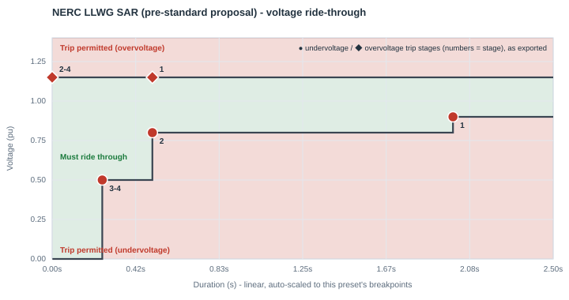
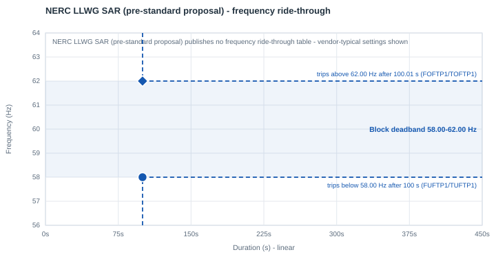

# NERC LLWG SAR (pre-standard proposal)

| | |
|---|---|
| **Preset ID** | `nerc_llwg_sar` |
| **Category** | Grid operator standard |
| **Status** | Proposed (pre-standard) — **not an adopted NERC Reliability Standard** |
| **Primary source** | NERC Reliability and Security Technical Committee (RSTC), Large Load Working Group (LLWG) computational-load disturbance-performance envelope, as reproduced in PJM Planning Committee, "PJM LCL Ride-through Requirements" (Sep 8, 2026), slides 12-13 |

## Summary

NERC's own internal working proposal for what a future computational-load
ride-through Reliability Standard might look like — produced by the RSTC's
Large Load Working Group. This is explicitly **not yet an adopted NERC
Reliability Standard**. It is included in this library because, unlike NERC
PRC-029-1 (also in this library — see [nerc_prc029.md](nerc_prc029.md)), it
is the one entry that is genuinely *about loads* rather than generation, so
it fits this library's pattern the same way ERCOT/MISO/SPP/PJM do.

## Primary source

Traced from the slide's own vector-drawn curve coordinates (not OCR/pixel
reading). The companion NERC Standards Authorization Request ("Reliability
Standards to Address Computational Load — Phase I," filed Feb 20, 2026) was
fetched and read directly: it is still in the Glossary/registration-criteria
scoping stage (defining "Computational Load"/"Computational Load Entity" as
new NERC Glossary terms), with the actual voltage/frequency ride-through
requirement explicitly **deferred to a later phase** of standard development
extending through 2027. The envelope below is NERC's own working proposal for
what that future standard may look like — informative, but not a filed or
binding number.

## Ride-through envelope

### Undervoltage (sag) floor

| Below this voltage (pu) | Must ride through for at least |
|---|---|
| 0.50 | 0.25 s |
| 0.80 | 0.50 s |
| 0.90 | 2.00 s |
| *(continuous above 0.90 pu, up to 1.10 pu)* | — |

### Overvoltage (swell) ceiling

| Up to this voltage (pu) | Must tolerate for at least |
|---|---|
| 1.15 | continuous — drawn flat, with no interior step visible in the source slide's 4 s window |

## Overcurrent limit

Not specified in the source slide.

## Post-disturbance recovery requirement

Not specified in the slide beyond the shape of the envelope itself — no
post-fault active-power recovery timing is shown for this proposal.

## Reconnection behavior (trip fraction, reconnect fraction, timing)

**Every field below is an app-chosen default, not a NERC-published number**
— this is the one preset in this library where none of the four fields
(trip fraction, reconnect fraction, reconnect delay, or ramp rate) has any
source in the primary material at all, unlike every other grid-operator
preset here (which at minimum specify a combined recovery-timing window).

- **Trip fraction (`FCEASE`)** — Not specified. `FCEASE=1.00` (full cease
  below `VDPA`), the same default used across this library.
- **Reconnect fraction (`FRECON`)** — Not specified. `FRECON=1.00` (full
  reconnect), the same default used across this library.
- **Reconnect delay (`TDRA`/Trecon)** — Not specified. `TDRA=0.917 s` —
  defaulted to ERCOT NOGRR282's own 1.0 s recovery window (see "Ramp rate"
  below for why ERCOT), minus this app's realistic power-electronics ramp
  benchmark, the same split convention used across this library — see [the
  index README](README.md#trip-fraction-reconnect-fraction-and-reconnect-timing-fceasefrecontdrarampa).
- **Ramp rate (`RAMPA`/Tramp)** — **Not specified; defaulted to ERCOT
  NOGRR282's own 1.0 s recovery window**, chosen because (a) it is the most
  mature, filed, PUCT-approved large-load standard in this library, (b)
  this proposal's own undervoltage envelope is already structurally
  identical to ERCOT's shape (minus ERCOT's deepest 0.20 pu tier — see "How
  this maps" below), and (c) this proposal is explicitly a precursor input
  toward a future NERC Reliability Standard for the same class of
  computational load ERCOT already regulates. Rather than modeling that
  entire second as one slow linear power ramp, this app sets `RAMPA=0.083 s`
  (5 cycles — borrowed from SPP's own published fast-recovery figure) as the
  actual ramp, with the rest (`TDRA=0.917 s`) as a confirmation dwell. The
  combined total (1.0 s) is a realistic placeholder grounded in the closest
  comparable published industry figure, not a NERC number — treat it
  accordingly in any study.

## Frequency ride-through

None yet - the companion NERC SAR explicitly defers the voltage/frequency ride-through requirement to a later phase of standard development, and the LLWG envelope this preset traces is voltage-only. The block keeps PERC1's vendor-typical frequency settings: a **58.0-62.0 Hz deadband**, tripping after 100 s outside it (`FUFTP1/TUFTP1 = 58.0 Hz / 100 s`, `FOFTP1/TOFTP1 = 62.0 Hz / 100.01 s`). If the facility's actual under/over-frequency protection is known, set the deadband in the block's **Frequency ride-through** row.

PERC1 has one frequency trip point per direction, so the block's frequency behavior is a **deadband**: it rides through indefinitely between `FUFTP1` and `FOFTP1`, and trips once frequency has been outside that band for `TUFTP1`/`TOFTP1`.

## Plots

### Voltage ride-through

Every exported trip stage is marked - ● undervoltage, ◆ overvoltage; the numbers are stage numbers, grouped where stages share a point.

### Frequency ride-through

The shaded blue band is the block's frequency deadband, with its two trip points (● under-frequency, ◆ over-frequency); red/green shading is the standard's own table where it publishes one.

## How this maps to the exported PERC1 CONs

This envelope's shape is structurally the same as ERCOT's minus its deepest
(0.20 pu) tier — 3 undervoltage rows, all 3 mapping onto PERC1's Option-3
stepped trip table exactly, with the deepest tier repeated into the unused
4th stage slot (see the
[index README](README.md#how-a-multi-tier-standard-becomes-a-full-multi-stage-psse-con-table); PSS/E testing confirmed that the model always evaluates
all four stages):

| Stage | Voltage (pu) | Duration (s) | CON pair |
|---|---|---|---|
| 1 (Option 1's own point) | 0.90 | 2.00 | `VDPA`/`DMA` |
| 2 | 0.80 | 0.50 | `VDPA1`/`DMA1` |
| 3 | 0.50 | 0.25 | `VDPA2`/`DMA2` |
| 4 (repeats stage 3 - no 4th real tier) | 0.50 | 0.25 | `VDPA3`/`DMA3` |

The overvoltage side has no finite mandatory tier at all (a flat ceiling) -
even less specified than the other presets' single-tier overvoltage sides -
so stage 1 uses `(1.15 pu, 0.50 s)` (the 0.50s duration is this app's own
export-time choice, not a NERC-published number - see below), and stages 2-4
repeat that same 1.15 pu voltage with `TDUA=0.0 s` rather than inventing a
higher breakpoint (see
[the index README](README.md#how-a-multi-tier-standard-becomes-a-full-multi-stage-psse-con-table)):

| Stage | Voltage (pu) | Duration (s) | CON pair |
|---|---|---|---|
| 1 (app's export-time choice) | 1.15 | 0.50 | `VDUA`/`TDUA` |
| 2 | 1.15 | 0.0 | `VDUA1`/`TDUA1` |
| 3 | 1.15 | 0.0 | `VDUA2`/`TDUA2` |
| 4 | 1.15 | 0.0 | `VDUA3`/`TDUA3` |

| CON | IT/UPS block | Cooling VFD block | Why they differ |
|---|---|---|---|
| `VDPA` (Vcease) | 0.90 pu | 0.90 pu | same — this proposal's own shallowest mandatory row, which also matches its own continuous floor |
| `DMA` (Tcease) | 2.00 s | 2.00 s | same |
| `VRPA` (Vrecon) | 1.00 pu | 1.00 pu | chosen inside this proposal's own continuous operating band (0.90-1.10 pu) |
| `VDUA` (high-voltage trip) | 1.15 pu | 1.15 pu | this proposal's own flat overvoltage ceiling |
| `TDUA` | 0.50 s | 0.50 s | chosen for plotting/export purposes; the slide draws the ceiling flat with no interior temporal step |
| `FCEASE` / `FRECON` | 1.00 / 1.00 | 1.00 / 1.00 | app default — not specified in the source — see "Reconnection behavior" above |
| `TDRA` (Trecon) | 0.917 s | 0.917 s | app default — not specified in the source; borrowed 1.0 s total from ERCOT NOGRR282, split per this app's ramp-rate benchmark |
| `RAMPA` (Tramp) | 0.083 s | 0.083 s | **app default, not standardized** — this app's realistic power-electronics ramp benchmark, borrowed total window from ERCOT NOGRR282 (see "Reconnection behavior" above), since this proposal publishes no recovery timing at all |
| `NPA` / `NQA` (ZIP exponent) | 1 / 1 (constant current) | 1 / 1 | |
| `IPMAXA` | 1.0 pu | 1.0 pu | this app's own neutral default — no overcurrent figure is specified in the source |

## Known caveats / limitations

- **`VRPA = 1.00` usually means "does not reconnect" in PSS/E.** The model
  reconnects only while the filtered voltage is strictly between `VRPA` and
  `VRUPA` (1.00-1.05 pu here). After a fault, a load bus usually settles a
  little below 1.00 pu, and the block then stays tripped, as the live
  chart also shows. For a study, consider `VRPA`
  0.90-0.95 pu (not below the highest undervoltage stage). See
  [Model behavior and limitations](../model_behavior.md#reconnection-needs-the-voltage-inside-a-window).
- **`DROOPA = 10` (vendor-typical) changes load by 16.7% per Hz** during
  frequency events (the live chart's frequency event shows it). See
  [frequency droop](../model_behavior.md#frequency-droop-is-large-and-always-on).
- **This is not an adopted or filed standard.** It is NERC's own internal
  working proposal, reproduced from a third party's (PJM's) comparison deck,
  for a Reliability Standard whose actual technical requirements are
  explicitly deferred to later standard-development work extending through
  2027. Treat this preset as directional/illustrative only.
- The companion NERC SAR that would eventually formalize this is still in
  the glossary/registration-criteria scoping stage as of the source
  document's filing date (Feb 20, 2026) — there is, as of this writing, no
  published technical ride-through table to re-verify this envelope against
  beyond the comparison slide it was traced from.
- No recovery-time or overcurrent obligation is specified anywhere in the
  source for this proposal, unlike ERCOT/SPP/PJM/MISO's own tables/text.
  This preset's `RAMPA` is therefore borrowed from ERCOT's own recovery
  window rather than sourced from this proposal — see "Reconnection
  behavior" above.
