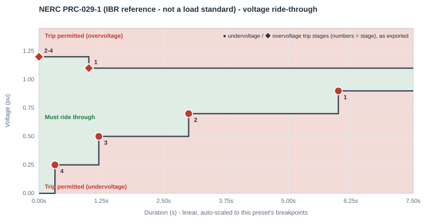
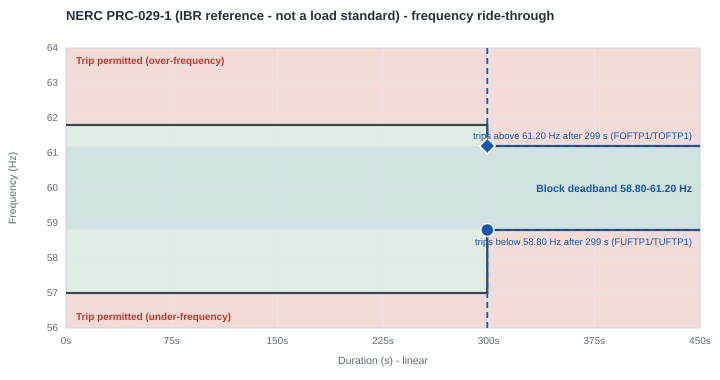

# NERC PRC-029-1 (IBR reference — not a load standard)

| | |
|---|---|
| **Preset ID** | `nerc_prc029` |
| **Category** | Grid operator standard (generator/IBR-side reference, included for comparison) |
| **Status** | **Adopted — FERC-approved** (governs generator/inverter-based resources, not load) |
| **Primary source** | NERC PRC-029-1, "Frequency and Voltage Ride-through Requirements for Inverter-based Resources," Attachment 1, Table 2 ("Voltage Ride-through Requirements for All Other IBR") |

## Summary

**This standard governs generator/inverter-based-resource (IBR) ride-through,
not load ride-through.** It is included in this library purely as the actual
industry comparison benchmark that grid-operator large-load proposals are
measured against — mirroring PJM's own methodology exactly: PJM's own slide
14 ("ERCOT, MISO, LLWG SAR, PRC-029 VRT Comparison") benchmarks
ERCOT/MISO/NERC-LLWG-SAR's *load* ride-through curves against PRC-029-1 and
IEEE 2800, not against ITIC. Selecting this preset does **not** mean a data
center facility is itself bound by PRC-029-1 — it lets you visually compare a
facility's configured trip point against the same reference curve PJM
benchmarks against, on this app's own live plot.

## Primary source

This is a real, adopted, binding NERC Reliability Standard — unlike every
other grid-operator entry in this library, it did not need any pixel-reading
or vector-tracing at all. Read directly from the Board-adopted standard text
(Draft 4_errata, Oct 2024). **FERC Order 909 approved this standard
Jul 24, 2025; effective Oct 1, 2026.**

Table 2 ("All Other IBR," the generally-applicable table — Table 1 is
wind-turbine-specific and is not modeled here) gives exact numbers. PJM's own
slide 14 independently labels its traced PRC-029-1/IEEE 2800 curve's deepest
point as "0.32" — matching this standard's own `<0.25 pu: 0.32 s` row
exactly, direct confirmation the two sources agree.

**IEEE 2800-2022** is cited by PJM alongside PRC-029-1 on the same comparison
curve (distinguishing "IBRs w/ aux equipment" vs. "IBRs w/o aux equipment" as
two close variants). IEEE standards are paywalled; this app models only the
PRC-029-1 numbers, which PJM's own chart treats as functionally the same
curve for comparison purposes.

## Ride-through envelope

### Undervoltage (sag) floor

| Below this voltage (pu) | Must ride through for at least |
|---|---|
| 0.25 | 0.32 s |
| 0.50 | 1.20 s |
| 0.70 | 3.00 s |
| 0.90 | 6.00 s |
| *(continuous above 0.90 pu, up to 1.05 pu)* | — |

### Overvoltage (swell) ceiling

| Up to this voltage (pu) | Must tolerate for at least |
|---|---|
| 1.05-1.10 pu | technically "Continuous Operation" capped at 1800 s (30 min) — simplified here to a flat continuous ceiling at 1.10 pu, since 1800 s is far beyond any duration this app ever simulates or plots |
| 1.20 | 1.0 s |

## Overcurrent limit

Not specified in Table 2 (this table addresses voltage/frequency
ride-through, not current limiting).

## Post-disturbance recovery requirement

Real power restored to the pre-disturbance level or the currently available
level (whichever is lesser) within **1.0 s** of voltage returning from the
mandatory/permissive operation region to the continuous operation region.

## Reconnection behavior (trip fraction, reconnect fraction, timing)

- **Trip fraction (`FCEASE`)** — Not applicable as published (PRC-029-1
  governs generator/IBR active-power *curtailment* during ride-through, not
  a load "cease" concept — see the standard's-not-a-load-standard caveat
  above). `FCEASE=1.00` is this app's usual binary-cease default, carried
  over for consistency with the rest of this library, not a PRC-029-1
  number.
- **Reconnect fraction (`FRECON`)** — Not separately specified beyond "real
  power restored to pre-disturbance level," which this app reads as full
  restoration. `FRECON=1.00`.
- **Reconnect delay (`TDRA`/Trecon)** — Not separately specified — the
  standard gives one combined 1.0 s restoration window, not a "confirm, then
  ramp" split. This app allocates `TDRA=0.917 s` of that window as a
  confirmation dwell, with the remainder spent on the actual ramp (next row)
  — see the library-wide convention in [the index README](README.md#trip-fraction-reconnect-fraction-and-reconnect-timing-fceasefrecontdrarampa).
- **Ramp rate (`RAMPA`/Tramp)** — **Standardized total, app-derived split —
  the only preset in this library where the source specifies restoration to
  100% (not merely ≥90%).** Real power must be restored to the
  pre-disturbance level within 1.0 s of voltage returning to the continuous
  operation region. Rather than modeling that entire second as one slow
  linear power ramp, this app sets `RAMPA=0.083 s` (5 cycles — borrowed from
  SPP's own published fast-recovery figure) as the actual ramp, spending the
  rest of the window (`TDRA=0.917 s`) as a confirmation dwell first. The
  combined total (`TDRA+RAMPA=1.0 s`) is still an exact match to the
  standard's own 1.0 s deadline for 100% restoration, not merely a
  conservative approximation.

## Frequency ride-through

Read directly from PRC-029-1's own text, **Attachment 2, Table 3**
("Frequency Ride-through Capability Requirements"):

| System frequency | Minimum ride-through time |
|---|---|
| > 61.8 Hz | May trip |
| > 61.2 Hz | 299 s |
| 58.8-61.2 Hz | Continuous |
| < 58.8 Hz | 299 s |
| < 57.0 Hz | May trip |

This preset carries that table as `frequency_ride_through` and exports it
into PERC1's single frequency trip point per direction (the vendor model
uses only stage 1): `FUFTP1/TUFTP1 = 58.8 Hz / 299 s` and
`FOFTP1/TOFTP1 = 61.2 Hz / 299 s`, armed at the continuous band's edge. Below
57.0 Hz / above 61.8 Hz the table permits an immediate trip; the block still
waits the 299 s, which is compliant (riding through longer than required). Two parts of the requirement are not modeled: Table 3's
durations are cumulative over a 10-minute window, and Requirement R3 also
requires riding through a rate of change of frequency up to 5 Hz/s.

PERC1 has one frequency trip point per direction, so the block's frequency behavior is a **deadband**: it rides through indefinitely between `FUFTP1` and `FOFTP1`, and trips once frequency has been outside that band for `TUFTP1`/`TOFTP1`.

## Plots

### Voltage ride-through

Every exported trip stage is marked - ● undervoltage, ◆ overvoltage; the numbers are stage numbers, grouped where stages share a point.

### Frequency ride-through

The shaded blue band is the block's frequency deadband, with its two trip points (● under-frequency, ◆ over-frequency); red/green shading is the standard's own table where it publishes one.

## How this maps to the exported PERC1 CONs

PRC-029-1's own Table 2 has 4 undervoltage rows - a precise, not approximate,
fit onto PERC1's 4-stage Option-3 trip table (see the
[index README](README.md#how-a-multi-tier-standard-becomes-a-full-multi-stage-psse-con-table); PSS/E testing confirmed that the model always evaluates
all four stages). No padding/repetition is needed - every stage is a real,
independently-published row:

| Stage | Voltage (pu) | Duration (s) | CON pair |
|---|---|---|---|
| 1 (Option 1's own point) | 0.90 | 6.00 | `VDPA`/`DMA` |
| 2 | 0.70 | 3.00 | `VDPA1`/`DMA1` |
| 3 | 0.50 | 1.20 | `VDPA2`/`DMA2` |
| 4 | 0.25 | 0.32 | `VDPA3`/`DMA3` |

Stage 1's own trip delay is the **longest** in the entire library (6.00 s,
vs. 2.00 s for ERCOT/SPP/MISO/NERC-LLWG-SAR) — consistent with PRC-029-1
being a generator/IBR ride-through requirement, which is typically held to a
stricter (longer mandatory ride-through) standard than proposed load curves.
The overvoltage side has two real published setpoints: the continuous
ceiling (simplified to `1.10 pu` - see the envelope table above) and one
mandatory tier (`1.20 pu / 1.00 s`); PRC-029-1's own text is silent on
anything beyond the tier. Read literally, "up to 1.20 pu: tolerate for at
least 1.0 s" describes the whole band above the continuous ceiling, not a
threshold that only starts mattering at 1.20 pu — so a swell anywhere over
1.10 pu can trip after the published 1.0 s (it cannot ride through 1.15 pu
indefinitely), while a swell over 1.20 pu can trip essentially immediately.
PERC1's `VDUA`/`TDUA` mechanism needs stage 1 armed at the band's own lower
edge (1.10 pu) to reproduce that; stages 2-4 arm at the published tier's
own voltage (1.20 pu) with `TDUA=0.0 s` — no intermediate voltage is
invented, both setpoints are PRC-029-1's own (see
[the index README](README.md#how-a-multi-tier-standard-becomes-a-full-multi-stage-psse-con-table)):

| Stage | Voltage (pu) | Duration (s) | CON pair |
|---|---|---|---|
| 1 (arms above the continuous ceiling) | 1.10 | 1.00 | `VDUA`/`TDUA` |
| 2 (arms above the published tier - immediate trip) | 1.20 | 0.0 | `VDUA1`/`TDUA1` |
| 3 | 1.20 | 0.0 | `VDUA2`/`TDUA2` |
| 4 | 1.20 | 0.0 | `VDUA3`/`TDUA3` |

| CON | IT/UPS block | Cooling VFD block | Why they differ |
|---|---|---|---|
| `VDPA` (Vcease) | 0.90 pu | 0.90 pu | same — PRC-029-1's own shallowest mandatory row |
| `DMA` (Tcease) | 6.00 s | 6.00 s | same |
| `VRPA` (Vrecon) | 1.00 pu | 1.00 pu | chosen inside PRC-029-1's own continuous operating band (0.90-1.05 pu) |
| `VDUA` (high-voltage trip) | 1.10 pu | 1.10 pu | PRC-029-1's own continuous-ceiling boundary - the band above it (up to 1.20 pu) is where the 1.0 s mandatory tolerance applies |
| `TDUA` | 1.00 s | 1.00 s | PRC-029-1's own 1.0 s minimum ride-through for the 1.10-1.20 pu band |
| `FCEASE` / `FRECON` | 1.00 / 1.00 | 1.00 / 1.00 | app default — PRC-029-1 describes IBR curtailment, not a load "cease" concept — see "Reconnection behavior" above |
| `TDRA` (Trecon) | 0.917 s | 0.917 s | app-derived split — PRC-029-1's own 1.0 s window minus this app's ramp-rate benchmark |
| `RAMPA` (Tramp) | **0.083 s** | **0.083 s** | **standardized total (1.0 s), exact match, app-derived split** — this app's realistic power-electronics ramp benchmark (see "Reconnection behavior" above) |
| `NPA` / `NQA` (ZIP exponent) | 1 / 1 (constant current) | 1 / 1 | |
| `IPMAXA` | 1.0 pu | 1.0 pu | this app's own neutral default — Table 2 does not specify a current limit |

## Known caveats / limitations

- **`VRPA = 1.00` usually means "does not reconnect" in PSS/E.** The model
  reconnects only while the filtered voltage is strictly between `VRPA` and
  `VRUPA` (1.00-1.05 pu here). After a fault, a load bus usually settles a
  little below 1.00 pu, and the block then stays tripped, as the live
  chart also shows. For a study, consider `VRPA`
  0.90-0.95 pu (not below the highest undervoltage stage). See
  [Model behavior and limitations](../model_behavior.md#reconnection-needs-the-voltage-inside-a-window).
- **`DROOPA = 10` (vendor-typical) changes load by 16.7% per Hz** during
  frequency events (the live chart's frequency event shows it). See
  [frequency droop](../model_behavior.md#frequency-droop-is-large-and-always-on).
- **This governs generator/IBR ride-through, not load ride-through.** A data
  center facility is not directly bound by PRC-029-1; this preset exists
  purely as the reference curve the industry's own methodology (PJM's
  comparison deck) benchmarks load proposals against. Do not cite this
  preset as a load-side compliance requirement in a filing.
- **Table 1 (wind-turbine-specific IBR) is not modeled** — it has different,
  generally tighter numbers than Table 2 and is out of scope for this app.
- The 1.05-1.10 pu "Continuous Operation" tier is technically capped at
  1800 s (30 min) in the standard's own text, simplified here to a flat
  continuous ceiling since no duration this app ever simulates or plots
  approaches 1800 s.
