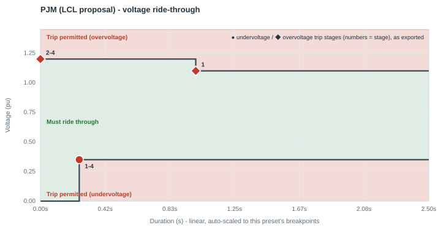
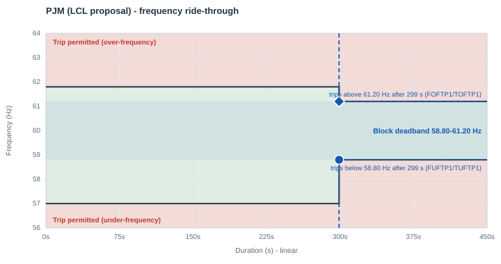

# PJM — Large Computational Load (LCL) proposal

| | |
|---|---|
| **Preset ID** | `pjm_lcl` |
| **Category** | Grid operator standard |
| **Status** | Proposed — **not adopted** |
| **Primary source** | PJM Planning Committee, "PJM LCL Ride-through Requirements — PJM Interconnection Proposal" (David Egan, Byoungkon Choi; Sep 8, 2026), slide 5 |

## Summary

PJM's own proposed ride-through envelope for **Large Computational Loads
(LCLs)**, developed in direct response to a FERC order questioning whether
PJM's tariff adequately addresses large-load ride-through, ramp-rate, and
restoration behavior. This is an active proposal under stakeholder review,
explicitly **not yet adopted** — PJM's own deck carries the disclaimer that
"applicable requirements may change; PJM Governing Documents control."

## Primary source

Filed in response to **FERC Docket EL26-67-000**, a Section 206 "Show Cause
Order" issued June 18, 2026. Re-extracted directly from the deck's own PDF
text layer (not a pixel-traced chart). PJM's own proposed envelope (slide 5)
only numerically marks **two** breakpoints on its own chart: a vertical line
at 0.25 s and a horizontal line at 0.35 pu — the single interior tier below
is exactly (and only) that.

PJM's own review timeline (as of the source deck): Planning Committee
education session Sep 15, 2026; tariff language review through Oct 2026;
**FERC filing targeted for November 2026**; full LCL design envelope
stakeholder-endorsed target Q3 2027.

## Ride-through envelope

### Undervoltage (sag) floor

| Below this voltage (pu) | Must ride through for at least |
|---|---|
| 0.35 | 0.25 s |
| *(continuous from 0.35 pu up to 1.10 pu — PJM's own chart states no additional trip allowance across this whole band)* | — |

PJM's chart draws the 0.35-0.90 pu band as one continuous, non-trip zone —
there are no additional interior tiers at 0.50/0.80 pu the way ERCOT's,
SPP's, and MISO's curves have.

### Overvoltage (swell) ceiling

| Up to this voltage (pu) | Must tolerate for at least |
|---|---|
| 1.10 | continuous (0.90-1.10 pu, consuming pre-disturbance active power) |
| 1.20 | 1.0 s |

## Overcurrent limit

**150%** of normal maximum current, confirmed directly from the slide's own
text.

## Post-disturbance recovery requirement

May reduce active power proportional to the voltage drop within the
0.35-0.90 pu band, but must return to ≥90% of pre-disturbance consumption
within **2 s** of voltage recovering above 0.9 pu (and below 1.1 pu). Cooling
load is specifically allowed to trip below 0.35 pu.

## Reconnection behavior (trip fraction, reconnect fraction, timing)

- **Trip fraction (`FCEASE`)** — **Not standardized as a discrete fraction**
  for the IT/UPS block. PJM's own language is continuous ("may reduce active
  power proportional to the voltage drop"), which PERC1 Option 1's binary
  cease logic cannot reproduce directly — `FCEASE=1.00` is this app's
  approximation, not a PJM-published number (same caveat as ERCOT's preset).
  The **cooling VFD block is a partial exception**: PJM's slide explicitly
  states cooling load "is specifically allowed to trip" below 0.35 pu, which
  at least confirms full trip (`FCEASE=1.00`) is within PJM's own stated
  allowance for that block specifically, unlike the IT block where full trip
  is this app's approximation rather than an explicit PJM allowance.
- **Reconnect fraction (`FRECON`)** — Not separately specified. `FRECON=1.00`
  (full reconnect) is this app's default, same reasoning as ERCOT's preset.
- **Reconnect delay (`TDRA`/Trecon)** — Not separately specified — PJM's text
  gives one combined 2.0 s recovery window, not a "confirm, then ramp"
  split. This app allocates `TDRA=1.917 s` of that window as a confirmation
  dwell, with the remainder spent on the actual ramp (next row) — see the
  library-wide convention in [the index README](README.md#trip-fraction-reconnect-fraction-and-reconnect-timing-fceasefrecontdrarampa).
- **Ramp rate (`RAMPA`/Tramp)** — **Standardized total, app-derived split.**
  PJM requires ≥90% of pre-disturbance power restored within 2.0 s of
  voltage recovering above 0.9 pu (and below 1.1 pu). Rather than modeling
  that entire window as one slow linear power ramp, this app sets
  `RAMPA=0.083 s` (5 cycles — borrowed from SPP's own published
  fast-recovery figure) as the actual ramp, spending the rest of the window
  (`TDRA=1.917 s`) as a confirmation dwell first. The combined total
  (`TDRA+RAMPA=2.0 s`) still reaches 100% restored by PJM's own deadline —
  conservative, never slower than required.

## Frequency ride-through

PJM's proposal: continuous 58.8-61.2 Hz;
may ride through down to 57.0 Hz / up to 61.8 Hz for up to 299 s while
holding consumption within 10% of pre-disturbance level. This preset carries
it as its `frequency_ride_through` table and exports it into PERC1's single
frequency trip point per direction: trip below 58.8 Hz / above 61.2 Hz after
299 s (see the library README's "Frequency ride-through" section). The "within 10% of
pre-disturbance consumption" condition is not modeled.

PERC1 has one frequency trip point per direction, so the block's frequency behavior is a **deadband**: it rides through indefinitely between `FUFTP1` and `FOFTP1`, and trips once frequency has been outside that band for `TUFTP1`/`TOFTP1`.

## Plots

### Voltage ride-through

Every exported trip stage is marked - ● undervoltage, ◆ overvoltage; the numbers are stage numbers, grouped where stages share a point.

### Frequency ride-through

The shaded blue band is the block's frequency deadband, with its two trip points (● under-frequency, ◆ over-frequency); red/green shading is the standard's own table where it publishes one.

## How this maps to the exported PERC1 CONs

PJM's own chart has only **one** finite (non-continuous) undervoltage row, so
this library's multi-stage mapping (see the
[index README](README.md#how-a-multi-tier-standard-becomes-a-full-multi-stage-psse-con-table))
has no other real tier to pick from — the single published row,
`(0.35 pu, 0.25 s)`, becomes `VDPA`/`DMA` **and** is repeated into all 3 of
PERC1's remaining Option-3 stages (`VDPA1-3`/`DMA1-3`), since a repeated
stage fires at the exact same time as the tier it copies and so introduces
no different, earlier trip (PSS/E testing confirmed that the model always
evaluates all 4 stages). This is notably a **shallower, faster-tripping**
point than ERCOT/SPP/MISO's `(0.90 pu, ...)` points, simply because PJM's
own proposal doesn't publish an intermediate mandatory tier the way the
other three do — not because PJM's proposal is less protective overall (its
continuous floor is the same 0.90-1.10 pu band as ERCOT/SPP/MISO).

The overvoltage side has two real published setpoints: the continuous
ceiling (`1.10 pu`) and one mandatory tier (`1.20 pu / 1.00 s`); PJM's own
slide is silent on anything beyond the tier. Read literally, "up to 1.20 pu:
tolerate for at least 1.0 s" describes the whole band above the continuous
ceiling, not a threshold that only starts mattering at 1.20 pu — so a swell
anywhere over 1.10 pu can trip after the published 1.0 s (it cannot ride
through 1.15 pu indefinitely), while a swell over 1.20 pu can trip
essentially immediately. PERC1's `VDUA`/`TDUA` mechanism needs stage 1
armed at the band's own lower edge (1.10 pu) to reproduce that; stages 2-4
(`VDUA1-3`/`TDUA1-3`) arm at the published tier's own voltage (1.20 pu)
with `TDUA=0.0 s` (see [the index
README](README.md#how-a-multi-tier-standard-becomes-a-full-multi-stage-psse-con-table)):
`(VDUA=1.10, TDUA=1.00)`, then `(1.20 pu, 0.0 s)` x3.

| CON | IT/UPS block | Cooling VFD block | Why they differ |
|---|---|---|---|
| `VDPA` (Vcease) | 0.35 pu | 0.35 pu | PJM's only published interior tier |
| `DMA` (Tcease) | 0.25 s | 0.25 s | same |
| `VRPA` (Vrecon) | 1.00 pu | 1.00 pu | chosen inside PJM's own continuous operating band (0.90-1.10 pu) |
| `VDUA` (high-voltage trip) | 1.10 pu | 1.10 pu | PJM's own continuous-ceiling boundary - the band above it (up to 1.20 pu) is where the 1.0 s mandatory tolerance applies |
| `TDUA` | 1.00 s | 1.00 s | PJM's own 1.0 s minimum ride-through for the 1.10-1.20 pu band |
| `FCEASE` / `FRECON` | 1.00 / 1.00 | 1.00 / 1.00 | app default for IT (binary approximation); VFD's full-trip allowance is explicit in PJM's own slide — see "Reconnection behavior" above |
| `TDRA` (Trecon) | 1.917 s | 1.917 s | app-derived split — PJM's own 2.0 s window minus this app's ramp-rate benchmark |
| `RAMPA` (Tramp) | **0.083 s** | **0.083 s** | **standardized total (2.0 s), app-derived split** — this app's realistic power-electronics ramp benchmark (see "Reconnection behavior" above) |
| `NPA` / `NQA` (ZIP exponent) | 0 / 0 (constant power) | 0 / 0 | |
| `IPMAXA` | **1.50 pu** | **1.50 pu** | PJM's own 150% overcurrent cap |

## Known caveats / limitations

- **`VRPA = 1.00` usually means "does not reconnect" in PSS/E.** The model
  reconnects only while the filtered voltage is strictly between `VRPA` and
  `VRUPA` (1.00-1.05 pu here). After a fault, a load bus usually settles a
  little below 1.00 pu, and the block then stays tripped, as the live
  chart also shows. For a study, consider `VRPA`
  0.90-0.95 pu (not below the highest undervoltage stage). See
  [Model behavior and limitations](../model_behavior.md#reconnection-needs-the-voltage-inside-a-window).
- **`DROOPA = 10` (vendor-typical) changes load by 16.7% per Hz** during
  frequency events (the live chart's frequency event shows it). See
  [frequency droop](../model_behavior.md#frequency-droop-is-large-and-always-on).
- **This preset represents an active, unadopted proposal — treat it as a
  placeholder, not a compliance target.** PJM's finished tariff language
  (targeted FERC filing Nov 2026, full design envelope target Q3 2027) may
  differ from what's modeled here. Do not use this preset for a final
  compliance filing without confirming PJM's current tariff language.
- **An earlier revision of this preset fabricated three additional interior
  tiers** (0.50/0.80/0.90 pu, all at a flat 2.0 s) not supported by PJM's own
  slide, and inverted the continuous ("no trip") marker onto the *deepest*
  band instead of the *shallowest* — the resulting curve had a floor pinned
  near 0 pu out to nearly 2 seconds. This was corrected by re-extracting the
  deck's own PDF text layer directly; the current envelope (above) reflects
  only the two breakpoints PJM's own chart actually marks.
- **Frequency ride-through's power condition is not modeled** — the
  frequency table itself is exported (above), but PJM's requirement to hold
  consumption within 10% of its pre-disturbance level has no PERC1 CON
  equivalent; the analytic preview holds power flat until a trip.
