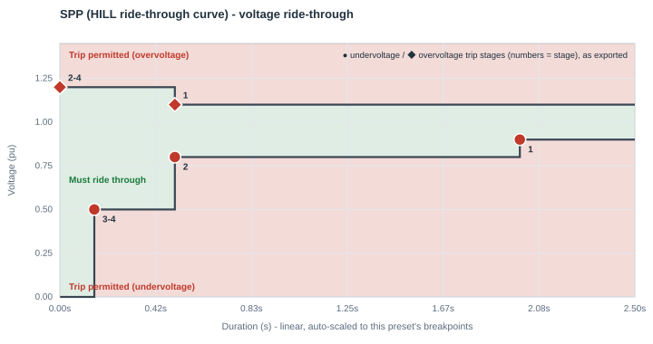
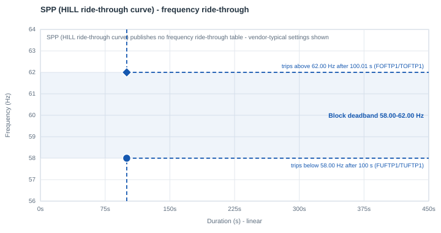

# SPP — HILL ride-through curve

| | |
|---|---|
| **Preset ID** | `spp_hill` |
| **Category** | Grid operator standard |
| **Status** | Adopted (published) |
| **Primary source** | SPP Operations & Planning Policy & Research Team, "High Impact Large Load Ride-Through Requirements," v0.1, Table 1 — published 8/15/2025 |

## Summary

SPP's published ride-through requirement for **High Impact Large Loads
(HILLs)** — SPP's term for the same category of facility ERCOT calls "Large
Electronic Loads." This is a binding v0.1 requirements document, not a
discussion slide or draft.

## Primary source

Read directly from SPP's own filed document, Table 1. An earlier revision of
this preset cited IEEE 1668/PRC-029 as the source — those standards apply to
*generators/IBRs paired with* a HILL (per §4.2 of SPP's own document), not to
the HILL's own voltage curve, which is Table 1 and is SPP's own number set.
SPP's document states this curve was informed by both ITIC/CBEMA and ERCOT's
proposal, but is not identical to either.

## Ride-through envelope

### Undervoltage (sag) floor

| Below this voltage (pu) | Must ride through for at least |
|---|---|
| 0.50 | 0.15 s (~9 cycles) |
| 0.80 | 0.50 s |
| 0.90 | 2.00 s |
| *(continuous above 0.90 pu, up to 1.10 pu)* | — |

### Overvoltage (swell) ceiling

| Up to this voltage (pu) | Must tolerate for at least |
|---|---|
| 1.10 | continuous (0.90 ≤ V ≤ 1.10 pu is the continuous band) |
| 1.20 | 0.5 s |
| *(above 1.20 pu)* | may ride through or trip |

## Overcurrent limit

Not specified — SPP's document explicitly leaves current limiting "TBD."

## Post-disturbance recovery requirement

Requires **constant-current (not constant-power) control** during
disturbances — directly relevant to this app's `NPA`/`NQA` ZIP-exponent
selector (constant-current = exponent 1, which is how this preset is
parameterized). Below 0.5 pu, load may transfer fully to UPS, but must
restore ≥90% of pre-disturbance grid consumption within **5 cycles
(~0.083 s)** of voltage recovering to ≥0.9 pu — markedly faster than
ERCOT's/PJM's 1-2 s recovery windows.

## Reconnection behavior (trip fraction, reconnect fraction, timing)

- **Trip fraction (`FCEASE`)** — **Not standardized as a discrete fraction.**
  SPP's own text permits load to "transfer fully to UPS" below 0.5 pu but
  does not give a fixed trip-fraction figure independent of that continuous
  behavior. `FCEASE=1.00` is this app's binary approximation, not an
  SPP-published number (same reasoning as ERCOT's/PJM's/MISO's presets).
- **Reconnect fraction (`FRECON`)** — Not separately specified. `FRECON=1.00`
  (full reconnect) is this app's default.
- **Reconnect delay (`TDRA`/Trecon)** — Not separately specified — SPP's
  text gives one combined recovery window (below). `TDRA=0.0 s`.
- **Ramp rate (`RAMPA`/Tramp)** — **Standardized, derived directly from
  SPP's own clause — the tightest window in this library.** SPP requires
  ≥90% of pre-disturbance consumption restored within 5 cycles (~0.083 s) of
  voltage recovering to ≥0.9 pu. This app sets `RAMPA=0.083 s`, reaching
  100% by SPP's own deadline. This is a genuinely fast ramp relative to a
  typical PSS/E dynamic simulation time step — see "Known caveats" below.

## Frequency ride-through

The sources this preset draws on give SPP's frequency requirement only as a **continuous 58.8-61.2 Hz band**, with no ride-through durations outside it - not enough to set a trip delay from, so it is not encoded. The block keeps PERC1's vendor-typical frequency settings: a **58.0-62.0 Hz deadband**, tripping after 100 s outside it (`FUFTP1/TUFTP1 = 58.0 Hz / 100 s`, `FOFTP1/TOFTP1 = 62.0 Hz / 100.01 s`). If the facility's actual under/over-frequency protection is known, set the deadband in the block's **Frequency ride-through** row.

PERC1 has one frequency trip point per direction, so the block's frequency behavior is a **deadband**: it rides through indefinitely between `FUFTP1` and `FOFTP1`, and trips once frequency has been outside that band for `TUFTP1`/`TOFTP1`.

## Plots

### Voltage ride-through

Every exported trip stage is marked - ● undervoltage, ◆ overvoltage; the numbers are stage numbers, grouped where stages share a point.

### Frequency ride-through

The shaded blue band is the block's frequency deadband, with its two trip points (● under-frequency, ◆ over-frequency); red/green shading is the standard's own table where it publishes one.

## How this maps to the exported PERC1 CONs

SPP's own table has 3 undervoltage rows - all 3 map onto PERC1's Option-3
stepped trip table exactly, with the deepest tier repeated into the unused
4th stage slot (see the
[index README](README.md#how-a-multi-tier-standard-becomes-a-full-multi-stage-psse-con-table); PSS/E testing confirmed that the model always evaluates
all four stages):

| Stage | Voltage (pu) | Duration (s) | CON pair |
|---|---|---|---|
| 1 (Option 1's own point) | 0.90 | 2.00 | `VDPA`/`DMA` |
| 2 | 0.80 | 0.50 | `VDPA1`/`DMA1` |
| 3 | 0.50 | 0.15 | `VDPA2`/`DMA2` |
| 4 (repeats stage 3 - no 4th real tier) | 0.50 | 0.15 | `VDPA3`/`DMA3` |

The overvoltage side has two real published setpoints: the continuous
ceiling (`1.10 pu`) and one mandatory tier (`1.20 pu / 0.50 s`); SPP's own
table is silent on anything beyond the tier. Read literally, "up to 1.20 pu:
tolerate for at least 0.5 s" describes the whole band above the continuous
ceiling, not a threshold that only starts mattering at 1.20 pu — so a swell
anywhere over 1.10 pu can trip after the published 0.5 s (it cannot ride
through 1.15 pu indefinitely), while a swell over 1.20 pu can trip
essentially immediately. PERC1's `VDUA`/`TDUA` mechanism needs stage 1
armed at the band's own lower edge (1.10 pu) to reproduce that; stages 2-4
arm at the published tier's own voltage (1.20 pu) with `TDUA=0.0 s` — no
intermediate voltage is invented, both setpoints are SPP's own (see
[the index README](README.md#how-a-multi-tier-standard-becomes-a-full-multi-stage-psse-con-table)):

| Stage | Voltage (pu) | Duration (s) | CON pair |
|---|---|---|---|
| 1 (arms above the continuous ceiling) | 1.10 | 0.50 | `VDUA`/`TDUA` |
| 2 (arms above the published tier - immediate trip) | 1.20 | 0.0 | `VDUA1`/`TDUA1` |
| 3 | 1.20 | 0.0 | `VDUA2`/`TDUA2` |
| 4 | 1.20 | 0.0 | `VDUA3`/`TDUA3` |

| CON | IT/UPS block | Cooling VFD block | Why they differ |
|---|---|---|---|
| `VDPA` (Vcease) | 0.90 pu | 0.90 pu | same — SPP's own shallowest mandatory row, which also matches SPP's own continuous floor |
| `DMA` (Tcease) | 2.00 s | 2.00 s | same |
| `VRPA` (Vrecon) | 0.90 pu | 0.90 pu | chosen at SPP's own continuous operating floor (0.90-1.10 pu) |
| `VDUA` (high-voltage trip) | 1.10 pu | 1.10 pu | SPP's own continuous-ceiling boundary - the band above it (up to 1.20 pu) is where the 0.5 s mandatory tolerance applies |
| `TDUA` | 0.50 s | 0.50 s | SPP's own 0.5 s minimum ride-through for the 1.10-1.20 pu band |
| `FCEASE` / `FRECON` | 1.00 / 1.00 | 1.00 / 1.00 | app default (binary approximation of SPP's "transfer fully to UPS" language) — see "Reconnection behavior" above |
| `TDRA` (Trecon) | 0.0 s | 0.0 s | app default — SPP gives one combined recovery window, not a separate confirm-delay |
| `RAMPA` (Tramp) | **0.083 s** | **0.083 s** | **standardized** — SPP's own ≥90%-within-5-cycle recovery clause, the fastest in this library |
| `NPA` / `NQA` (ZIP exponent) | 1 / 1 (constant current) | 1 / 1 | SPP's own requirement for constant-current control during disturbances |
| `IPMAXA` | 1.0 pu | 1.0 pu | this app's own neutral default — SPP specifies no overcurrent cap ("TBD") |

## Known caveats / limitations

- **Overcurrent is left at this app's neutral default (1.0 pu)** because SPP
  itself has not yet specified a value — this is not an omission on this
  app's part.
- **`RAMPA=0.083 s` is a genuinely fast ramp for a PSS/E dynamic
  simulation** — comparable in magnitude to a typical simulation time step
  (`TRA`'s own guidance recommends a numerical filter constant of ~4x the
  time step; `TRA=0.02 s` here is already close to a quarter of this ramp).
  This is a faithful representation of SPP's own requirement, not a
  simplification, but confirm your simulation's time step is small enough
  to resolve a ~0.083 s ramp before relying on the reconnection transient's
  shape in a real study.
- **Known, real (non-error) deviation from ITIC** (informational, since this
  app no longer compares against ITIC anywhere): SPP's continuous-band floor
  (0.90 pu) takes effect at t = 2.0 s, while ITIC's rises to 0.90 pu only at
  t = 10 s — SPP's curve is laxer than ITIC's in that narrow window. A real,
  reproducible property of SPP's own published Table 1, not a transcription
  artifact.
