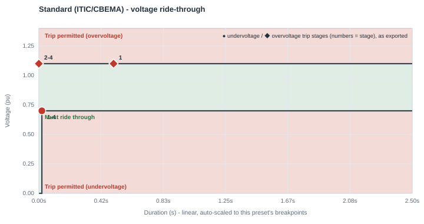
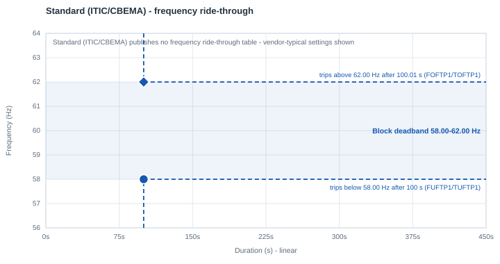

# Standard (ITIC/CBEMA)

| | |
|---|---|
| **Preset ID** | `standard_itic` |
| **Category** | Generic (internal engineering tier, not a grid-operator standard) |
| **Status** | Adopted (internal) |
| **Primary source** | Internal engineering tiering — [Generic parameter tiers](../parameter_tiers.md#1-generic-ride-through-tiers) |

## Summary

Represents equipment rated to just clear the ITIC/CBEMA equipment-tolerance
curve — the middle of the three generic tiers, used when a facility's
equipment is described as "standard"/typical UPS or VFD hardware with no
special ride-through rating and no vendor spec sheet yet on hand.

Despite the name, **this preset is not compared against ITIC anywhere in the
app** — no panel in the live plot draws or references the ITIC curve (see
[../ridethrough_presets/README.md](README.md#why-these-numbers-and-not-iticcbema)
for why). The name reflects only where this tier's own single trip point
(`VDPA=0.70` at `DMA=0.02s`) was historically chosen to sit relative to that
curve's 20 ms-500 ms plateau, as a design anchor — not an ongoing runtime
comparison.

This is **not** a grid-operator or reliability-standard requirement — it is
this app's own internal engineering judgment call, used as a starting point pending real vendor or field data.

## Ride-through envelope

### Undervoltage (sag) floor

| Below this voltage (pu) | Must ride through for at least |
|---|---|
| 0.70 | 0.02 s |
| *(continuous above 0.70 pu)* | — |

### Overvoltage (swell) ceiling

| Up to this voltage (pu) | Must tolerate for at least |
|---|---|
| 1.10 | continuous (no published finite tier) |

## Overcurrent limit

Not specified (uses the model's neutral 1.0 pu `IPMAXA` default).

## Post-disturbance recovery requirement

Not applicable — a single-point internal tier, not a standard with its own
recovery-timing language.

## Frequency ride-through

None - this internal tier is voltage-only. The block keeps PERC1's vendor-typical frequency settings: a **58.0-62.0 Hz deadband**, tripping after 100 s outside it (`FUFTP1/TUFTP1 = 58.0 Hz / 100 s`, `FOFTP1/TOFTP1 = 62.0 Hz / 100.01 s`). If the facility's actual under/over-frequency protection is known, set the deadband in the block's **Frequency ride-through** row.

PERC1 has one frequency trip point per direction, so the block's frequency behavior is a **deadband**: it rides through indefinitely between `FUFTP1` and `FOFTP1`, and trips once frequency has been outside that band for `TUFTP1`/`TOFTP1`.

## Plots

### Voltage ride-through

Every exported trip stage is marked - ● undervoltage, ◆ overvoltage; the numbers are stage numbers, grouped where stages share a point.

### Frequency ride-through

The shaded blue band is the block's frequency deadband, with its two trip points (● under-frequency, ◆ over-frequency); red/green shading is the standard's own table where it publishes one.

## How this maps to the exported PERC1 CONs

| CON | IT/UPS block | Cooling VFD block | Why they differ |
|---|---|---|---|
| `VDPA` (Vcease) | 0.70 pu | 0.70 pu | same |
| `DMA` (Tcease) | 0.02 s | 0.10 s | VFD-driven cooling motors carry rotating inertia that lets them coast through a sag slightly longer than IT/UPS electronics before shedding load |
| `VRPA` (Vrecon) | 0.90 pu | 0.90 pu | `min(VDPA + 0.20, 0.95)` hysteresis above the trip point |
| `VDUA` (high-voltage trip) | 1.10 pu | 1.10 pu | same |
| `TDUA` | 0.50 s | 0.50 s | chosen for plotting/export purposes; no published temporal figure for this tier's overvoltage side |
| `FCEASE` / `FRECON` | 1.00 / 1.00 | 1.00 / 1.00 | full trip, full reconnect |
| `NPA` / `NQA` (ZIP exponent) | 0 / 0 (constant power) | 0 / 0 | constant-power assumption |
| `IPMAXA` | 1.0 pu | 1.0 pu | this app's own neutral default, not a vendor/standard mandate |

## Known caveats / limitations

- This is an internal engineering placeholder, explicitly labeled
  a placeholder in the app's report until overridden with
  vendor/spec-sheet or field-validated data.
- A prior revision of this app's live plot drew this tier's trip point
  against a permanently-visible ITIC curve on every chart, with a
  compliant/non-compliant verdict phrased in ITIC terms. That comparison was
  removed app-wide (not just relabeled) once it became clear that no grid
  operator or NERC standard actually benchmarks large-load ride-through
  against ITIC — see the index README's "Why these numbers, and not
  ITIC/CBEMA" section. This preset's *numbers* are unchanged; only the
  always-on ITIC overlay was removed.
